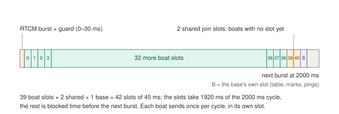
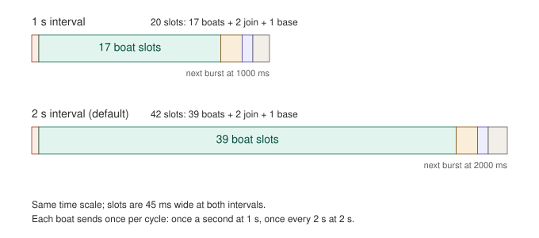
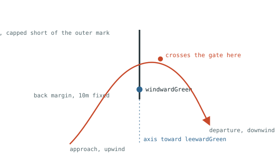

# Race Tracker — Boat Agent + Base Station

Reports GPS position from a boat (Pi Zero 2 W + simpleRTK2B LR) to a shore/
committee base station over a long-range telemetry radio (>2 mi), with
logging to microSD as a durable backup.

## Architecture

```
[simpleRTK2B LR]--UART-->[Pi Zero 2 W]--UART-->[Telemetry radio]==RF==>[Telemetry radio]--UART-->[Base station]--> race software
                              |
                              v
                    microSD (CSV, same fixes sent over radio)
```

For the complete rover → base → RegattaUp data flow - wire formats, Redis
keys, webhook payloads, RegattaUp's own entity fields - see
[`docs/telemetry-pipeline.html`](docs/telemetry-pipeline.html) (open in a
browser).

| Component | Notes |
|---|---|
| GPS | ZED-F9P, `UBX-NAV-PVT` binary messages (position, speed, heading, fix type, RTK carrier solution, satellite count) - no NMEA needed |
| Radio | Transparent-serial telemetry radio (RFD900x, SiK, etc). A compact 26-byte binary frame (`src/protocol.js`) minimizes airtime - batched 8 at a time by default (delta-coded, 83 bytes), see `TX_BATCH_SIZE` below |
| SD log | Logged exactly when a fix clears the `TX_DISTANCE_M`/`TX_INTERVAL_S` gate - same gate as the radio send, so the SD record mirrors what actually transmitted rather than a separate full-rate trace |


**How the gate measures.** A fix clears the gate when the boat has moved `TX_DISTANCE_M` (default 1 m) from the last fix that *cleared* it, or `TX_INTERVAL_S` (default 60 s) has passed since then - the last fix that cleared the gate, not the last one actually sent (`distanceGate.js`). In slot mode a fix waits up to a cycle for its slot; measured from the last fix *sent*, the gate stayed open for that whole wait, so a boat creeping at 1.3 kn sent clusters of eight fixes a millimetre apart, then nothing for two seconds, and a heartbeat that fell due sent eight copies of one position. Now consecutive fixes are at least `TX_DISTANCE_M` apart and a heartbeat adds one fix. A boat faster than about 19 kn at 10 Hz moves more than a metre per fix, so it still sends every fix. A send that fails (radio not connected yet) hands the reference back to the last fix that really went out, so the boat keeps retrying.

## Wiring notes

Default config uses the Pi's own dedicated hardware UART (`/dev/ttyAMA0`,
GPIO 14/15 - avoid the mini-UART, its clock is tied to the core clock and
can glitch), leaving the one USB/OTG port free for the telemetry radio
alone.

```
sudo raspi-config   # Interface Options -> Serial Port
                     # "login shell over serial" = No
                     # "serial port hardware enabled" = Yes
```

- Prefer the simpleRTK2B's own USB port (`/dev/ttyACM0`) instead? Set
  `GPS_PORT=/dev/ttyACM0` (and matching `GPS_BAUD`) - simpler wiring, but
  needs a USB hub since the radio then needs its own USB-to-serial adapter.
- Any Pi with onboard Bluetooth (Zero 2 W, 3A+/3B+, 4, ...) puts GPIO14/15
  on the glitch-prone mini-UART (`ttyS0`) by default, since Bluetooth
  occupies the real UART. Fix:
  ```
  # /boot/firmware/config.txt (Bookworm+) or /boot/config.txt (older)
  dtoverlay=disable-bt
  ```
  then disable `hciuart`/`bluetooth` services and reboot.
- Which physical UART (UART1 vs UART2) your wiring reaches depends on the
  board - ArduSimple's simpleRTK2B routes UART2 to the XBee socket (used
  for RTCM correction radios, unrelated to this app), so a general
  breakout pin is more likely UART1 - verify, don't assume (see below).

### Radio sleep wiring (XBee SLEEP_RQ)

Optional - only needed for rover radio sleep mode (see "Radio sleep mode"
below). One extra wire from a Pi GPIO to the XBee's SLEEP_RQ pin, next to
the radio's UART wiring above:

| From | To | Notes |
|---|---|---|
| Pi **GPIO17** (header pin 11, 3.3 V) | XBee **pin 9** (SLEEP_RQ / DTR) | High = radio asleep, low = awake |
| Pi GND (header pin 9, right next to pin 11) | XBee GND | Shared ground, usually already there via the UART wiring |
| 10 kohm resistor | XBee pin 9 to GND | Pull-down, so the radio stays awake while the Pi is off or still booting |

- **Why GPIO17:** GPIO9-27 are pulled *down* at boot, whereas GPIO0-8 are
  pulled *up* and would put the radio to sleep during every Pi boot. GPIO17
  also isn't claimed by anything this app uses or by a default overlay (UART
  GPIO14/15, I2C GPIO2/3, SPI GPIO7-11, 1-wire GPIO4, PWM/PCM GPIO12/13/18/19),
  and sits on header pin 11 with GND on pin 9 beside it, so one short
  cable can carry the UART (pins 8/10) and this wire. Any other free GPIO
  from 9-27 works; set `RADIO_SLEEP_GPIO` to its BCM number.
- **XBee setting:** the radio must be in pin-sleep mode - `ATSM1`, then `ATWR`
  (for example from XCTU). `xbee_configure_at.py` does not set this. Do it only
  once the wire and pull-down are in place, because in `SM=1` a pin driven
  high puts the radio to sleep and it cannot be reached over the UART until
  the pin goes low again.
- **If the radio is on a USB-serial bridge** whose DTR line is also wired to
  XBee pin 9 (needed only for serial firmware updates), use a jumper or
  solder bridge so just one of the two drives the pin - never both.
- Optional: XBee ON_SLEEP (pin 13) to a spare Pi GPIO input, or an LED, to
  see the radio's actual sleep state. The app doesn't read it.
- `RADIO_SLEEP_GPIO=17` tells the rover app which pin to drive. Unset (the
  default), a real rover ignores sleep commands. It uses Raspberry Pi OS's
  `pinctrl` command to drive the pin.

### GPS backup battery (V_BCKP)

Not a wire - a factory option on the ArduSimple board. It keeps the GPS's
satellite data alive so the rover restarts hot instead of cold. Whether your board
needs it is something to check, not assume: see "Checking and fitting the GPS
backup battery" under "Radio sleep mode".

## GPS configuration (one-time, from a computer)

The rovers never configure the GPS module or the radio - the Pi only reads fixes. Set the ZED-F9P up from a computer
over the board's own USB port, with `ubx_config_set.py` (or u-center):

```
pip install pyserial
python3 ubx_config_set.py --port <the board's USB port> --role rover --dry-run   # shows what it would change
python3 ubx_config_set.py --port <the board's USB port> --role rover
```

The rover profile turns `UBX-NAV-PVT` on (without it this app sees nothing), sets 10 Hz, disables TMODE3, turns
`UBX-RXM-RTCM` on, and sets UART2's baud to match the XBee in the board's socket. It writes to RAM, BBR and flash, so it
survives a power cycle, and reads every value back. Each UART is configured independently - the UART the Pi's wires reach
may still be at factory defaults (NMEA on, UBX off) even after another port was configured. The profile sets
`UBX-NAV-PVT` on UART1; if the Pi's wires reach UART2, check with the verification step below. The XBee is configured
separately with `xbee_configure_at.py`. Don't install `gpsd` on a rover - it grabs the serial port.

To see what a port is outputting before you configure anything, try the common bauds (9600, 19200, 38400, 57600,
115200) until you see clean `$GNGGA`/`$GNRMC`/... text:

```
stty -F /dev/ttyAMA0 <baud> raw -echo
cat /dev/ttyAMA0        # Ctrl-C to stop
```

`setup-gps-uart.sh` on the Pi only frees the UART (serial console off, Bluetooth off, `dialout` group); it does not touch
the GPS module.

### Verifying the connection

```
stty -F /dev/ttyAMA0 115200 raw -echo
cat /dev/ttyAMA0        # expect quiet gaps + a short binary burst ~1/sec
```
Then confirm this app itself decodes it (the check that actually matters):
```
GPS_PORT=/dev/ttyAMA0 GPS_BAUD=115200 npm run boat
```
Watch for `[gps]` lines with real `fixType`/`numSV` (see `GPS_LOG`; `npm run print-config` lists every
setting). Silence means `UBX-NAV-PVT` went to the wrong UART number
- undo (`CFG-MSGOUT-UBX_NAV_PVT_UARTx,0,7`) and try the other.

The simpleRTK2B LR's onboard radio (in the board's XBee socket) is a
**separate concern** - it carries RTCM3 correction data between RTK base
and this rover, not position telemetry. "LR" is ArduSimple's own kit name
("Long Range," about 10 km), not a Digi product name - confirmed off the
module's label, the chip is a **Digi XBee SX** (Model XBSX, FCC ID
`MCQ-XBSX`); the step-up "XLR" kit uses a Digi XBee PRO SX for longer
range.

### RTK base GPS: enabling RTCM3 output (one-time)

`TMODE3` (fixed/survey-in position, set from this app's `npm run
rtk`/`basertk` dashboard) and RTCM3 *output* are separate config groups -
setting a fixed position doesn't turn sending RTCM on. Some kits ship with
only `1005` enabled and no observation messages, which looks like "locked
and working" on the dashboard while the rover receives nothing usable.

Check/enable on the base's correction-radio UART (`UART2` on the
simpleRTK2B LR - its onboard XBee SX is wired internally to UART2, not
something you'd jumper yourself):

| Message | Content |
|---|---|
| `1005` | Station coordinates (depends on the fixed position) |
| `1074`/`1084`/`1094`/`1124` | MSM4 observations: GPS/GLONASS/Galileo/BeiDou |
| `1230` | GLONASS code-phase biases (needed alongside `1084`) |

Send **one** observation set, MSM4, not MSM4 and MSM7 together. MSM7 carries
the same observations at higher resolution and about 1.5x the bytes; sending
both is duplicate traffic (an audit found a board doing exactly that - the
factory MSM4 plus an MSM7 set added on top - roughly 2.5x the bytes the rover
needs). MSM4 is also the better fit for this fleet's radios: a whole epoch is
about 400 bytes, and individual messages stay near the 100-byte radio packet
limit (MSM7 messages go well past it and get split in two over the air, and
losing either half loses the message).

```
ubxtool -f <base GPS port> -s <baud> -P 27.11 -z CFG-MSGOUT-RTCM_3X_TYPE1005_UART2,1,7
ubxtool -f <base GPS port> -s <baud> -P 27.11 -z CFG-MSGOUT-RTCM_3X_TYPE1074_UART2,1,7
ubxtool -f <base GPS port> -s <baud> -P 27.11 -z CFG-MSGOUT-RTCM_3X_TYPE1084_UART2,1,7
ubxtool -f <base GPS port> -s <baud> -P 27.11 -z CFG-MSGOUT-RTCM_3X_TYPE1094_UART2,1,7
ubxtool -f <base GPS port> -s <baud> -P 27.11 -z CFG-MSGOUT-RTCM_3X_TYPE1124_UART2,1,7
ubxtool -f <base GPS port> -s <baud> -P 27.11 -z CFG-MSGOUT-RTCM_3X_TYPE1230_UART2,1,7
```
`ubx_config_set.py --role base` (below) does all of this on both UART1 and
UART2 and also switches the MSM7 messages off, which these commands alone don't.
Only enable constellations you're actually tracking. `,7` saves to flash
immediately (bare `,1` is RAM-only, for testing before committing).

For visibility into corrections arriving rover-side, enable `UBX-RXM-RTCM`
on the rover's own GPS UART and set `RTCM_LOG=1` (off by default; `GPS_LOG_RTCM` is the old name and still works):
```
ubxtool -f /dev/ttyAMA0 -s <baud> -P 27.11 -z CFG-MSGOUT-UBX_RXM_RTCM_UART1,1,7
```
Watch `[rtcm]` lines (`type=1074 station=0 used=used`) - `used=not used` on
its own is normal (unused constellations), `CRC-FAILED` means a correction
arrived corrupted. Message counts/CRC failures are always tracked
internally (`GET /api/stats`) regardless of this flag.

### RTK base GPS: enabling the survey-in status card (optional)

If the "Base GPS survey-in" card shows "no base GPS, or not polled yet"
even with `GPS_PORT` set and TMODE3 configured for survey-in,
`UBX-NAV-SVIN` likely isn't enabled as an output:
```
ubxtool -f /dev/ttyAMA0 -s 115200 -P 27.11 -z CFG-MSGOUT-UBX_NAV_SVIN_UART1,1,7
```
Configuring TMODE3 itself for survey-in (vs. just reading it) is a
separate one-time step, typically done via u-center at setup - see
u-blox's ZED-F9P integration manual for survey-in parameters.

### Checking everything at once (gps_config_report.sh)

`gps_config_report.sh` (repo root) polls every setting the sections above
depend on - fix rate, UART baud, `UBX-NAV-PVT`/NMEA/`UBX-NAV-SVIN`/
`UBX-RXM-RTCM` output, TMODE3 mode, RTCM3 output types - in one pass,
instead of re-typing each `ubxtool -g` poll by hand or assuming a board's
still configured the way it was last time. Read-only (`-g`/poll only,
never `-z`/set):
```
./gps_config_report.sh -f /dev/ttyAMA0 -s 115200
```
A board acting as a rover should show the RTK-base rows (TMODE3, RTCM3
output) at 0/off; a board acting as the RTK base should show its own rows
enabled and `CFG-TMODE-MODE` non-zero.

No `gpsd`/`ubxtool` available (or can't install it)? `ubx_config_report.py`
reports the exact same settings, talking the UBX binary protocol directly
over `pyserial` instead - same reasoning as `xbee_configure_at.py`'s own
"why not a library" comment, no external CLI tool needed:
```
pip install pyserial
python3 ubx_config_report.py --port /dev/ttyAMA0 --baud 115200
```
Every key ID it polls is cross-checked against two independent open-source
references (SparkFun's u-blox GNSS library and pyubx2), not typed from
memory - see its own module comment.

`ubx_config_set.py` applies the fix, same no-`ubxtool`-needed approach:
```
python3 ubx_config_set.py --port /dev/ttyAMA0 --baud 115200 --role base
python3 ubx_config_set.py --port /dev/ttyAMA0 --baud 115200 --role rover
```
`--role base` makes the base's RTCM output clean: `1005`, the MSM4 observations
(`1074`/`1084`/`1094`/`1124` - GPS/GLONASS/Galileo/BeiDou) and `1230` on, the
MSM7 messages (`1077`/`1087`/`1097`/`1127`) explicitly off, RTCM3 allowed as an
output protocol, and `UBX-NAV-SVIN` on - on the ports named by `--rtcm-ports`
(default `uart2,usb`: UART2 is the onboard correction radio, USB the host
connection), with every other port's RTCM switched off so nothing is sent where
nothing reads it. Add `uart1` only if something reads the board on the Pi header
UART. `--constellations` (default all four) leaves constellations out to save
bytes - a left-out one has its MSM4 message off, and `1230` goes with GLONASS.
`--rtcm-interval N` (default 2) sends every enabled message every N seconds instead of every
second (it sets the messages' output rate in measurement epochs, and the base profile also sets the receiver's
measurement rate to 1 Hz so an epoch is a second - at the rover profile's 10 Hz, "2 epochs" would be 0.2 s, about eight
times the intended correction airtime, which is what happens if the rover profile is ever applied to a base receiver):
`--rtcm-interval 2` halves the correction airtime, at the cost of rovers working from corrections up
to 2 s old and a lost message costing 2 s. Check that RTK still holds at speed before relying on it.
`--station-interval N` (default 10) sends the 1005 station-position message every N seconds instead of with every burst
(never more often than `--rtcm-interval`). The base's position is fixed, so a rover only needs to hear it now and then; it
is what a rover needs before it can start an RTK fix, so a boat that powers up waits up to N seconds for its first one.
Sending it less often also removes a small message that would otherwise arrive a second away from the observations.

Run it with `--dry-run` first to see exactly what would change, and
`ubx_config_report.py` afterwards to confirm; it writes RAM+BBR+flash, so it
survives a power cycle.
```
python3 ubx_config_set.py --port /dev/cu.usbmodem101 --role base --dry-run
python3 ubx_config_set.py --port /dev/cu.usbmodem101 --role base --constellations gps,galileo,beidou
```

The RTCM message rates are written together, in one command (off, then on), whenever any of them changes: each message's output
counter starts when its rate is written, so rates written one by one can end up on different seconds. `--realign-rtcm` does the
same off-and-on for a receiver whose rates already read correctly. To see what the base is really sending, with every message's
arrival time and the gaps between them (stop the base first so the radio port is free):
```
python3 rtcm_listen.py --port /dev/cu.usbserial-0001 --seconds 20 --timeline
```

The base role also prints the receiver's current TMODE3 mode as its first line
(`TMODE3 mode = 1 (survey-in)`, `2 (fixed position)` or `0 (disabled)`). A receiver is only a base while TMODE3 is
survey-in or fixed; at 0 it sends no usable corrections and the admin dashboard's survey-in card says "disabled".
That happens when the rover profile, which sets TMODE3 to 0, is applied to the same receiver. So **if it reads 0 the
base role turns survey-in on** (the receiver averages its own position for at least `--svin-min-dur` seconds, default
300, until it is within `--svin-acc-limit-m` metres, default 2.0, then starts sending corrections; the dashboard's
survey-in card shows the progress). A fixed position or a survey already running is left alone. `--survey-in` forces
survey-in even over a fixed position, replacing it:
```
python3 ubx_config_set.py --port /dev/cu.usbmodem101 --role base --dry-run               # shows what it would do
python3 ubx_config_set.py --port /dev/cu.usbmodem101 --role base --survey-in             # replace a fixed position
```
Survey-in gives a new averaged position, which can differ by a metre or two from an earlier surveyed or fixed one - if
the course marks were planted against the old reference, restore the old fixed coordinates or plant them again.

This replaces an earlier profile that added MSM7 on top of the board's factory
MSM4 (a live audit then found both sets going out the radio). The original gap
it was written for - `1005` station coordinates on and no observation message at
all, so a rover would never get a usable correction - is still covered. All four
constellations are on by default, not gated behind opt-in flags - this fleet
operates in the US, where all four have real satellites in view (including
BeiDou-3's global coverage, not just the old Asia-Pacific-only BeiDou-2), and more
satellites means better RTK fix reliability under real-world sky obstruction;
edit `BASE_SETTINGS` directly if you want fewer.
`--role rover` enables `UBX-NAV-PVT`
(required, or this app sees nothing from it), disables TMODE3 (a rover
isn't a stationary reference station), enables `UBX-RXM-RTCM` (for
`RTCM_LOG` visibility), and sets the fix rate to 10Hz (`CFG-RATE-MEAS`)
- not the ZED-F9P's 20Hz spec ceiling, to leave headroom. (An earlier version of
this note cited u-blox's "link latency under nav-period minus 50ms" rule; the
integration manual gives that rule for *moving-base* RTK only, not for a
stationary base like this one, so it isn't a reason for 10Hz here. For a
stationary base the manual's documented limit is that the rover stops using
corrections older than 60 s - `CFG-NAVSPG-CONSTR_DGNSSTO`.)
It also accepts RTCM3 as an input on UART2 (the correction radio's port),
makes sure GPS/GLONASS/Galileo/BeiDou tracking are all on (the rover can only
use corrections for constellations it tracks) and sets the differential mode to
3 = RTK fixed (2 would stop at float).

**Both roles** set UART2's baud (`--uart2-baud`, default 115200) - UART2 is the
port the onboard correction radio is wired to, so it **must equal that radio's
own baud** (the base's reads 115200). Only UART2 is touched, never the port the
script is connected through. If your correction radios aren't at 115200, pass
their baud instead of accepting the default.

Every write goes to
RAM+BBR+Flash (survives a power cycle) and is read back afterward to
confirm it actually stuck - a silently-failed write is worse than a loud
one. `--dry-run` shows what would change without writing anything.

## Radio configuration

Pair every radio (boat + base) on the same netid/frequency/baud, in
transparent-serial mode.

| | Factory default | This app's default |
|---|---|---|
| XBee baud | 9600 | **115200** |
| RFD900x/SiK baud | 57600 | **115200** |

At fleet sizes beyond a couple boats, the base↔radio serial link (every
boat's frames funnel through one port) becomes the bottleneck well below
the radio's actual RF capacity - hence 115200. Reconfigure **every**
radio's serial baud via XCTU (XBee) or RFD Modem Tools/Mission Planner
(RFD900x) before running with this default; a mismatch just means the
port opens but nothing decodes. Also confirm all radios share the same
Network ID (XBee `ID`).

**Don't raise this past 115200 without re-testing.** It's tempting to - a
100-boat `radio-congestion` run at 115200 measured the SERIAL link
saturating at about 11.2 KB/s, almost exactly 115200's own 8N1 ceiling (115200 ÷
10 bits/byte = 11,520 B/s), apparently well under an XBee-PRO 900HP 200K's
nominal RF capacity. Bumping to 230400 does relieve that serial ceiling
(the same test then pushed 15.4 KB/s, using only about 67% of 230400's own
about 23 KB/s ceiling) but sync errors jumped from 0.2% to 10.4% - real
RF-level bit corruption (see `radioLink.js`'s own `sync-error` event), not
local serial buffering, since bandwidth used stayed well under the new
ceiling. This fleet's actual radios' real sustainable RF throughput tops
out around 11-12 KB/s regardless of serial baud - 115200 was accidentally
already throttling right at that ceiling, not artificially limiting it.
`TX_BATCH_SIZE` (reduces actual RF bytes-per-fix, not just how fast the
serial link can be fed - see "Batching multiple fixes per send" below) is
already at its practical ceiling by default (4, `MAX_BATCH_COUNT`) - there's
no more headroom left there to reach for if you need still more real fix
throughput. Re-run the same `radio-congestion` test checking sync-error
rate, not just bandwidth headroom, before trusting any higher baud.

Running only 1-2 boats? Leave everything at factory defaults and set
`RADIO_BAUD` to match. Higher baud = faster delivery but shorter
range/reliability at a given power - tune on the water. **Antenna height
matters a lot for going over water at >2mi.**

### Configuring XBee radios (xbee_configure_at.py)

For XBee-PRO S3B (900HP/XSC) radios, `xbee_configure_at.py` (repo root)
automates the above instead of using XCTU by hand: DigiMesh delivery mode,
routing/relaying disabled on every node (single-hop fleet only), matching
Network ID/DH-DL/HP/MT/BD. Every command/value comes from Digi's XBee-PRO
900HP/XSC S3/S3B User Guide - not `MM`/`CH`/`CD`, which don't exist on
this module (confirmed live: both `ERROR`). No base-vs-rover split - every
radio gets identical config. Speaks plain AT Command Mode over `pyserial`
("+++", "ATxx<value>", "ATWR") - never leaves transparent mode.

```
pip install pyserial

python3 xbee_configure_at.py --port /dev/ttyUSB0             # every radio
python3 xbee_configure_at.py --port /dev/ttyUSB0 --dry-run    # read only
python3 xbee_configure_at.py --port /dev/ttyUSB0 --role rtcm  # an XBee-PRO 900HP as the RTK correction radio
```

| Flag | Default | Notes |
|---|---|---|
| `--connect-baud` | 115200 | The radio's CURRENT speed - pass its actual current baud if already reconfigured, or `9600` for a genuinely factory-fresh radio |
| `--target-baud` | 115200 | Applied last (changes how the script itself talks to the radio), matches `RADIO_BAUD` |
| `--mode` | `p2mp` | `p2mp` / `digimesh` / `digimesh-routing` |
| `--role` | `telemetry` | What the radio is for. `telemetry`: network ID `0x7FFF`, `HP` 0, `MT` 0 (the position link). `rtcm`: network ID `0x1985`, `HP` 1, `MT` 1 (each broadcast sent twice), no flow control - the RTK correction link on its **own network**, so a yacht's two XBee-PRO 900HP radios never hear each other's data. Set **both ends** of each link the same |
| `--network-id` / `--preamble-id` / `--mt` | from `--role` | Override a single value of the preset: `ID` (0 - 0x7FFF), `HP` (0 - 7), `MT` (0 - 5) |
| `--flow-control` | `cts` | `none` (D7=0, D6=0) / `cts` (D7=1, D6=0 - Digi's own factory default) / `rtscts` (D7=1, D6=1). CTS is an output the radio raises when its serial buffer is nearly full - harmless if the host ignores it. **RTS makes the radio stop sending to the app while RTS is held high**, so use `rtscts` only with an adapter whose RTS line is wired and driven, or the radio goes silent to the app. The app itself opens the port without hardware flow control today, so these settings only take effect once it (or the adapter's driver) honours them |

**Encryption (`EE`) is switched off** by the script (and `--dry-run` shows it as the `EE (Encryption)` row). With AES on, every RF packet loses 9 bytes of its 100-byte payload, so the marks frame (91 bytes) would still fit but the slot table (up to 97) and power (up to 95) frames would be split across two packets and lost if either half is. `EE` has to be the same on every radio in the network, so run the script on all of them (or check each with `--dry-run`).

The stock ArduSimple LR radio's settings, side by side with each preset above, are
recorded in [`docs/xbee-radio-settings.md`](docs/xbee-radio-settings.md).

**Not for the stock ArduSimple long-range radios.** Those are XBee SX modules
paired on their own network ID (`0x1985`); running this script for real on one
would change its settings (a dry run is safe and just reads them). `--role rtcm` is
for replacing *both* ends of the correction link with XBee-PRO 900HPs; try it on the
bench first (ZED to radio to radio to ZED, with `RTCM_LOG=1` on the rover) before
relying on it. `CM` (the channel mask) is still not set by this script, so two
900HP networks on one yacht still hop across the same frequencies.

Config values (network ID, DH/DL, etc.) live in the `CONFIG` dict at the
top of the script, not as flags, except those the flags above override. Channel selection (`CM`) isn't touched at
all - set by hand first if avoiding specific frequencies. Only one process
can hold a serial port - stop any running `npm run base`/`boat`/`radio-test`
or XCTU on that port first.

**Mode history**: DigiMesh (`TO=0xC0`) is confirmed-working and was the
long-time default. Point-to-Multipoint (`TO=0x40`, lower overhead, no
network header) failed traffic between two persistently-verified P2MP
radios on this hardware - a real incompatibility, not config/persistence.
As of this pass **P2MP is the new default** based on further review (one
open lead: DigiMesh's own broadcasts already reuse Directed-Broadcast wire
framing, not unique DigiMesh framing, since this app's traffic is 100%
broadcast - so the earlier "working" DigiMesh test never actually
exercised mesh-routing behavior). Fall back with `--mode digimesh` if P2MP
doesn't work on your hardware. A real (non-dry-run) run soft-resets (`FR`)
and reconnects to re-verify every parameter survives a reboot, not just
reads back correctly mid-session.

### Bench-testing the radios

```
RADIO_TEST_MODE=send   RADIO_PORT=/dev/cu.usbserial-A npm run radio-test
RADIO_TEST_MODE=listen RADIO_PORT=/dev/cu.usbserial-B npm run radio-test
```

`src/radioTest.js` exercises the real radio link directly (no GPS, Redis,
or simulation) using the exact same `RadioLink`/`protocol.js` code
production uses. One instance per radio (`ls /dev/cu.*` before/after
plugging in to find device paths on macOS). `RADIO_BAUD` and Network ID
(`ATID`) must match on both.

Sender transmits one frame every `RADIO_TEST_INTERVAL_MS` (default 500ms)
with a sequence number in the timestamp field. Listener logs received
frames and prints a running summary every 10s (received count, estimated
missed, loss %). Start close together to confirm connectivity, then
separate to find where the link degrades.

**Measuring radio latency and the slot guard (`radio-latency`).** A time-slot schedule needs a
*guard time* - how much a frame's arrival can vary - and that should be measured, not guessed.
Two radios on one machine, one sending and one listening, give one-way latency from "the app wrote
the frame" to "the other radio's app decoded it", with the send and receive times from the same clock:

```
LATENCY_TX_PORT=/dev/cu.usbserial-5 LATENCY_RX_PORT=/dev/cu.usbserial-0001 npm run radio-latency
```

1. Power the RTK base and let it send corrections (so there are RTCM bursts to measure against).
   With the base off the test still gives latency, just without the near-burst comparison.
2. Put two radios on the machine, both on the **same network** as the base (same `ID` and `HP`,
   115200 baud). `ls /dev/cu.*` before and after plugging each in to find their ports.
3. Stop anything else holding those ports (`cat`, miniterm, `npm run boat`, `rtcm_listen.py`).
4. Run the command above (about 80 seconds for 300 frames). Leave the radios alone while it runs.
5. Read the report: one-way latency percentiles (min, p50, p90, p99, max) and jitter (p99 - p50);
   latency and loss for frames sent *near* an RTCM burst versus *clear* of it; whether bursts that
   had a test frame near them came through incomplete more often than the others (that is what a
   telemetry transmission costs the corrections); and a suggested guard.
6. Repeat for a bigger frame and a longer run: `LATENCY_BATCH=8 LATENCY_FRAMES=600 ...` (an 83-byte delta frame of 8 fixes, the biggest a boat sends; `LATENCY_DELTA=0 LATENCY_BATCH=4` for the older 84-byte
   batch frame).
7. Swap which radio sends and which listens (the two ports) and run again, to see that the numbers
   don't depend on the radio.

Settings: `LATENCY_FRAMES` (300), `LATENCY_GAP_MS` (250, plus a random 0-40 ms so sends cover every
phase of the second), `LATENCY_BATCH` (1 = a 26-byte frame, 2-8 = a delta-coded frame of that many fixes - 8 is 83 bytes; `LATENCY_DELTA=0` sends the older batch frame instead, 2-4 fixes up to 84 bytes). The test fixes move, so every field of a delta frame is exercised, and the report counts frames that arrived with a good checksum but decoded to different values than were sent (radio corruption the additive checksum missed - it should be 0),
`LATENCY_FOCUS=1` (send only in a sweep from 80 ms before to 160 ms after each predicted correction burst, one frame per burst, to find exactly where sending hurts; needs the base running; 150 frames, about 150 s), `RADIO_BAUD` (115200). The guard it suggests is a starting point: one machine, two adapters. It does
not include a Raspberry Pi's own delays, so repeat it on a Pi before setting slot timing.

**Testing the transmit scheduler itself (`LATENCY_SCHEDULE`).** The same two-radio setup can run
the real `TxScheduler` instead of sending at random times, so you can see what the gate and the
slots do to the corrections. The sender radio listens for the base's bursts to learn the timing
(it waits for 3 bursts before sending), then each virtual boat sends through its own scheduler.

```
# A: no gate (baseline) - existing random-phase run, same load
LATENCY_BATCH=2 LATENCY_FRAMES=300 LATENCY_TX_PORT=<sender> LATENCY_RX_PORT=<listener> npm run radio-latency
# B: gate only - telemetry held out of the correction window
LATENCY_SCHEDULE=gate  LATENCY_BATCH=2 LATENCY_FRAMES=300 LATENCY_TX_PORT=<sender> LATENCY_RX_PORT=<listener> npm run radio-latency
# C: gate + slots - two virtual boats in slots 3 and 7, 45 ms wide (the default; the measurements below used 35). Add LATENCY_BATCH=8 LATENCY_GAP_MS=2000 for one 83-byte frame per 2 s cycle (a boat at 8 Hz sends two per cycle)
LATENCY_SCHEDULE=slots LATENCY_SLOTS=3,7 LATENCY_SLOT_MS=45 LATENCY_TX_PORT=<sender> LATENCY_RX_PORT=<listener> npm run radio-latency
```

The report shows, per boat, when each frame was actually written relative to the burst start
(slot mode: it should sit at the slot's opening, `30 + slot x slot width` ms), how long frames were
held, frames written inside the conflict window (should be 0), arrivals from different boats within
15 ms of each other (should be 0; the closest gap is printed too - neighbouring slots give about 21 ms or more), and bursts that came through incomplete with and without a
frame near them. Compare the incomplete-burst rate in A against B and C. `LATENCY_BOATS` sets the
number of virtual boats (default 1 for `gate`, one per `LATENCY_SLOTS` entry for `slots`).

**Looking at the raw bytes on a radio's port (macOS).** Don't use `stty -f <port> 115200`
followed by `cat <port> | xxd`: macOS resets the port to its default 9600 baud when
`cat` reopens it, so a 115200 radio's output reads as noise. Use a tool that sets the
baud itself when it opens the port - `python3 -m serial.tools.miniterm <port> 115200 --raw`,
or `rtcm_listen.py`:

```
python3 rtcm_listen.py --port /dev/cu.usbserial-0001 --seconds 20
```

`rtcm_listen.py` decodes the stream rather than dumping hex: checksum-valid RTCM3
messages (with type and size), UBX frames and NMEA sentences, how many bytes it
couldn't recognise, and how wide each second's burst is. "No valid frames" there
means the bytes really are corrupted, unlike a wrong-baud `cat`.

### Congestion-testing the radio

`npm run fleet`'s `SIMULATE=1` link is UDP with no airtime limit, so it
can't show real congestion; running real `FLEET_SIZE` boats needs one real
radio *per boat*. `src/radioCongestionTest.js` instead runs one process,
one real radio, transmitting the *combined* frame traffic a whole
simulated fleet at speed would put on the air - same
`protocol.js`/`RadioLink` frames, same per-boat `TX_DISTANCE_M` cadence,
computed directly rather than from a live GPS track.

```
npm run base                                                   # real base, real radio - NOT SIMULATE=1
BOAT_COUNT=30 RADIO_PORT=/dev/cu.usbserial-A npm run radio-congestion
```

The base treats this synthetic traffic exactly like a real fleet's - real
(non-zero) lat/lon, real-format boat ids - so with a real regatta selected
it gets written into that regatta's own Redis data (and, if RegattaUp
reporting is live, could fire real lap/on-grid webhook posts too). Run the
base with `NO_REGATTA=1 npm run base` for a pure bench test instead: it
skips regatta auto-selection entirely for that run (no terminal prompt, no
closest-active-date auto-pick), so every received frame - real or
synthetic - is ignored and nothing is written anywhere. The admin
dashboard's own regatta dropdown still works normally if you want to
override it mid-run.

Watch the base's fleet dashboard (last-seen/frame counts) and its
`[radio] link quality` log line (sync errors) as `BOAT_COUNT` climbs.
`CONGESTION_SPEED_KN` (default 26.1, ≈ 30mph - this fleet's own reference
planning speed, land yachts rather than displacement sailboats; still in
knots like every other speed value in this app, so a bare `30` here means
30 *knots* instead) sets the assumed speed driving send rate. This tests
airtime/throughput load on the base's real receive
pipeline - it is **not** a test of real multi-transmitter RF collisions
(every frame still leaves one real antenna); that needs one real radio per
virtual boat.

**For real collisions**, run several of these at once, each on its own
physical radio, `BOAT_ID_OFFSET`-staggered so their boat ids don't overlap
(purely cosmetic for telling frames apart on the dashboard - the actual RF
collision behavior only depends on the radios being physically separate
transmitters, not on the ids). Split a target fleet size across them to
get realistic aggregate load *and* genuine multi-transmitter contention at
once, rather than choosing between the two:

```
BOAT_COUNT=7 BOAT_ID_OFFSET=0  RADIO_PORT=<radio1> npm run radio-congestion
BOAT_COUNT=7 BOAT_ID_OFFSET=7  RADIO_PORT=<radio2> npm run radio-congestion
BOAT_COUNT=7 BOAT_ID_OFFSET=14 RADIO_PORT=<radio3> npm run radio-congestion
BOAT_COUNT=7 BOAT_ID_OFFSET=21 RADIO_PORT=<radio4> npm run radio-congestion
```

Physically separate the transmitting radios rather than clustering them -
radios that can all hear each other collide differently (often more
politely) than ones spread across a real course, where some pairs are
hidden nodes to each other but both still reach the base. That hidden-node
case is usually where the ugliest real collision behavior actually shows
up, and clustering hides it entirely.

### Marking the base's own log from a rover

A real field test - walking/driving a rover to a new distance from the
base, checking an antenna, anything worth timestamping - needs a way to
say "right now" without cross-referencing two separate logs by wall-clock
time afterward. Every rover's own dashboard (`roverAdminServer.js`, any
mode - plain boat, markset, or mark) has a **Mark base log** card: type a
short note (20 characters, truncated beyond that) and tap **Mark**. It
sends over the same telemetry radio a position fix already goes out on
(`protocol.js`'s `encodeMarkLog`/`0x88`) - no GPS fix or WiFi needed, works
even before this device has ever gotten a position.

The base logs it unconditionally to its own console
(`=== MARK from boat=... : "<note>" ===`), and - when `LOG_RATE_STATS=1` is
also set (see "Congestion-testing the radio" above) - appends it as its
own row in that same `base_station_rate_stats_<date>.csv`, numeric fields
blank, note filled in, landing inline with the fix-rate/error-rate time
series at the exact moment it was sent.

`radio-congestion` runs its own copy of this same dashboard too - same
port as any other rover's own admin dashboard (`ADMIN_PORT`, default 8092;
8093 under `SIMULATE=1`, same as `boatAgent.js`) - purely to reach this
card from a browser during a bench test. Every other card on
it (course marks, GPS fix, uploads, scheduled shutdown) just shows its own
honest "nothing yet" state, since this script tracks none of that; only
Mark base log actually does something. Tagged `boat=MARKS` on the base's
own console/CSV so it's never confused with one of the virtual boats' own
sequential ids.

### Batching multiple fixes per send (TX_BATCH_SIZE)

`TX_BATCH_SIZE` (default **8**) packs that many consecutive fixes from one
boat into a single radio transmission instead of sending each on its own -
fewer, larger over-the-air transmissions instead of many small ones. Set
`TX_BATCH_SIZE=1` to go back to one frame per fix, this app's original
behavior (boatAgent.js never touches the batch frame type at all at that
setting). Whether batching is actually worth the added latency (fixes wait
to fill a batch, though never longer than `TX_INTERVAL_S` - see below)
depends on whether your bottleneck is per-transmission overhead or
per-byte airtime; see the XBee-PRO 900HP/XSC S3B's own `NP` command (max
RF payload - 256 bytes on the standard 900HP, but read-only and check it
yourself: the "900HP 200K" variant's higher RF data rate caps it much
lower, 100 bytes on this fleet's actual radios) for the ceiling a batch
frame stays comfortably under - the older batch frame (`MAX_BATCH_COUNT` in
protocol.js) is capped at 4 fixes (84 bytes) to fit that, and the delta-coded
frame described next carries 8 fixes in 83 bytes, which is why 8 is the default
(it was 4 before delta frames): this fleet's own congestion-testing (see
"Congestion-testing the radio" above) found batching comfortably improves
aggregate throughput at this hardware's real payload ceiling. A boat waits to
fill a batch only when no correction bursts are heard on its radio - in slot
mode it sends what it has gathered once per cycle instead (see "Sending in the
slot").

**Delta-coded frames (`TX_DELTA`, on by default).** Batches go out as *delta frames* (sync `0xE7`): the first
fix in full (19 bytes) and every later fix as its change from the one before (8 bytes), so a frame holds up to
**8 fixes in 83 bytes** (the older batch frame needed 84 bytes for 4). Sizes: 2 fixes 35 bytes, 4 fixes 51,
5 fixes 59, 8 fixes 83, against 46/84/111/168 as batch frames. Latitude and longitude are exact; fixes
after the first in a frame have their time rounded to 2 ms, speed to 0.5 knot (so within 0.25) and heading to 2
degrees (so within 1; the encoder works from what the decoder will rebuild, so nothing drifts along a frame).
A fix whose change does not fit - a GPS jump, a gap over 510 ms, a speed step over 63 knots - simply starts a
new frame (a turn of any size fits: heading changes go the short way round, up to 180 degrees), which always opens with a full fix, so frames are self-contained and a lost frame never corrupts the
next. A lone fix is the plain 26-byte frame. **Update the base before the boats**: the base decodes both
frame types, but a base that does not know `0xE7` ignores delta frames. `TX_DELTA=0` makes boats send the
older batch frame (4 fixes at most) for use with an old base; `TX_BATCH_SIZE` is then limited to 4 (up to 8 with
delta frames, the default).

Test it with the same tool "Congestion-testing the radio" above uses -
`radio-congestion` respects `TX_BATCH_SIZE` too, so you can compare real
transmission rates at different batch sizes (or against `TX_BATCH_SIZE=1`)
at your actual fleet size before ever touching a real boat:

```
BOAT_COUNT=30 TX_BATCH_SIZE=4 RADIO_PORT=/dev/cu.usbserial-A npm run radio-congestion
```

The console's own "X frames sent, Y tx/s actual average" line (and the
base's `[radio] link quality` log) reflect actual transmissions, not
fixes - with batching on, that number drops roughly in proportion to
`TX_BATCH_SIZE` for the same fix rate. No env var needs setting on a real
boat to get this - `TX_BATCH_SIZE=8` is already the default:

```
npm run boat
```

**Timestamps inside a batch.** A fix's time is always its own GPS
`timestamp` (the Redis sorted-set score), so a 10 Hz simulator produces fixes
100ms apart even when 8 arrive in one frame. The base stores no
arrival time in a fix: it used to stamp each unpacked fix with `new Date()`
(a `receivedAt`), which gave every fix in a batch the identical value. Track
points returned from Redis still carry a `receivedAt` field for existing
consumers, but it is now just the GPS timestamp, including for fixes stored
before this change.

### RTCM on the shared radio (telemetry and corrections on one radio)

If the radio on a boat's/base's serial port is also the RTK correction link (every radio on
the same network ID and `HP` - see `docs/xbee-radio-settings.md`), the RTK base's RTCM3
messages arrive on that same serial port, mixed in with position frames, marks and the rest.

- **Recognised, never an error.** `radioLink.js` (and the UDP simulator) now treat an RTCM3
  message as its own frame type: `0xD3`, a 10-bit length, the payload, and a CRC-24Q that must
  check out (`protocol.js`'s `decodeRtcm`). Before this, RTCM bytes looked like noise: the same
  5-second test stream produced 965 sync errors, because payload bytes that happen to equal one
  of our own sync bytes (`0xAA`, `0xBB`, ...) were taken for the start of a frame; now it
  produces none, and the telemetry frames in between all decode. A false `0xD3` with an
  implausible length (over 300 bytes) is rejected straight away, so it can't make the scanner
  wait on a frame that never arrives. A corrupted RTCM message costs a couple of sync errors and
  nothing around it.
- **Counted.** The rover counts what arrives over the radio (`radioRtcm` in `GET /api/stats`:
  frames, bytes, forwarded, last type). That is separate from `rtcm`, which counts what the GPS
  receiver reports applying (`UBX-RXM-RTCM`). `RTCM_LOG=1` prints one tight line
  per second per source instead of a line per message:
  ```
  [rtcm-radio] 449B 6msg MSM4 1005:stn 1074:GPS8 1084:GLO7 1094:GAL3 1124:BDS7 1230:bias
  [rtcm] 6/6 used: 1005 1074 1084 1094 1124 1230
  ```
  The first is what arrived over the radio (bytes, message count, MSM level, and the number
  of satellites in each constellation's message, each tagged with its RTCM message number (`1074:GPS8` = message 1074, GPS, 8 satellites); `->GPS` is added when `RTCM_FORWARD` also
  wrote them to the receiver, and `!set changed (...)` appears if a burst's set of messages
  differs from the previous one). The second is what the GPS receiver reports applying; it
  names any message not used, and any with a CRC failure. `RTCM_LOG=2` prints a decoded line
  per message instead, e.g. `[rtcm-radio] 1074 GPS 8sv 12c 129B` (`c` = signal cells) and
  `[rtcm] 1074 used`. `GPS_LOG_RTCM` is the old name for this setting. A base's telemetry station hears the same RTCM and simply ignores it.
- **A lost frame never strands a boat.** The base detects the start, a lap (the finish) and the fouls from two consecutive fixes it
  received that straddle a line - one fix on each side is all it needs - so the boat makes sure that pair is sent:
  - it watches its own full-rate (10 Hz) fixes for the same crossings (`eventBoost.js`); when it sees one it sends the two fixes just
    before it, which its gates had dropped, and every fix for the next 0.6 s, whatever state it is in (parked, no slot, backing off);
  - near a windward or leeward mark or the finish line (`TX_SLOT_MARK_ZONE_M`, 80 m) it uses its whole slot, nothing is thinned
    away, and a boat under way is not paced (the mark roundings need several fixes inside the zone, so they rely on this);
  - a boat under way without a slot reports every 2 to 4 s, not every 15 s;
  - the distance gate counts a fix as reported only when its frame was actually written to the radio: if the scheduler drops it (queue
    full, too old, refused by the radio) the gate falls back to the last fix that really went out, so the next fix passes at once
    instead of a stationary boat staying silent until its 60 s heartbeat;
  - a parked boat whose report is not due yet keeps its newest fix for when it is, and repeats its first report once;
  - on the base, a fix that arrives late (older than one already seen) is not fed to the event detectors, so it cannot make a stale
    position the previous one and miss or double-count a crossing.
- **Warned about when missing.** A boat that does not hear the correction bursts is not slot-timed (it sends unslotted, on top
  of other boats) and probably is not getting RTK corrections either. After `RTCM_WATCHDOG_WARN_S` (20) seconds without a burst -
  counted from when the boat started if it has never heard one - the boat prints an orange (when the console is a terminal)
  `[rtcm] WARNING: no correction bursts heard …`, repeats it every `RTCM_WATCHDOG_REPEAT_S` (30) seconds while they stay
  missing, and prints `correction bursts heard again after N s` when they return. It is quiet while the radio sleeps on purpose.
  `RTCM_WATCHDOG=0` turns it off, for a boat whose corrections arrive on a separate radio, so it never hears bursts on this one.
- **Forwarded to the GPS only if asked.** With `RTCM_FORWARD=1` the rover writes each message,
  byte for byte, to the GPS receiver's serial port, which is what makes the shared radio an RTK
  link. That needs the Pi's TX line wired to the receiver's RX (nothing in this app wrote to the
  GPS before), and `ubx_config_set.py --role rover` now also accepts RTCM3 as an input on UART1
  and USB. Nothing is forwarded while the rover is in radio sleep: a byte written to a sleeping
  receiver wakes it.
- **Is the GPS getting the corrections? (boat dashboard, "RTK corrections" card.)** "Radio received" counts the
  correction messages the Pi heard on its radio; "GPS applied" counts what the receiver itself reports using; "Sent to
  GPS" counts what the Pi forwarded (only with `RTCM_FORWARD=1`). The headline reads "receiving" when the receiver
  applied one in the last 10 s, "stalled" after that, "none yet" before the first, and "not applied" if the radio is
  hearing corrections the receiver isn't using. On an ArduSimple board whose XBee sits in the board's socket, the radio
  feeds the receiver's UART2 directly, so no forwarding is needed - **provided UART2's baud equals the XBee's `BD`
  (115200)**. A receiver left at ArduSimple's 38400 hears the radio but decodes nothing: "Radio received" counts up while
  "GPS applied" stays 0 and the fix stays plain GPS. `ubx_config_set.py --role rover` sets UART2 to 115200 (check the
  dry-run's `UART2 baud` line, and that TMODE3 reads 0 - a non-zero TMODE3 means that receiver is a base). With
  `RTCM_FORWARD=1` the Pi's TX/RX wires to the receiver's UART1 do the same job when the board does not route the radio
  to UART2.

- **Is the boat keeping to its slot? (boat dashboard, "Transmit slot" card.)** The headline is the boat's slot ("slot 0"),
  "shared 39, 40" (the numbers of the shared join slots) while it has none of its own yet (parked on the grid, or waiting for
  the base to assign one), or "no bursts heard" when its radio hears no corrections, in which case nothing is slotted. The
  rows: how often the correction bursts arrive, the slot count and width ("41 x 45 ms"), whether the boat has heard the base's
  slot table ("not heard yet" means the count is what the boat works out from `RTCM_INTERVAL_S` and `TX_SLOT_MS`), frames sent in the slot, **Spilled** (frames that did
  not fit and went out a cycle later - nothing is lost; a few near marks is normal, one every cycle means the slot is too
  small: raise `TX_SLOT_MS` or lower `TX_SLOT_MAX_HZ`), **Expired / dropped** (frames discarded after waiting too long -
  those positions never went out, though they are on the SD card; a warning mark appears if either is above 0) and how many
  frames are waiting for the next slot. These are the counts the boat also prints as `[txgate-stats]` when it shuts down. The
  scheduler plans from an estimate of air time, so an actual overrun into a neighbour's slot shows up on the base instead
  (Link health's checksum failures and gaps for that boat).

### Shared-radio transmit scheduling (keep clear of the correction burst; optional time slots)

With one radio for telemetry and corrections, a frame written into the base's RTCM burst (one per correction interval) is
delayed and leaves the corrections incomplete (measured: 46% of bursts incomplete with a frame sent in the
conflict window, 1.8% otherwise - `docs/radio-latency-findings-2026-10-09.pdf`). This keeps writes clear of it.

- **Burst tracker** (`burstTracker.js`): times the first RTCM message of each burst as this radio decodes it,
  learns the period, predicts the next burst, and back-dates the start if the first messages of a burst were
  lost. It goes inactive after a few missed cycles. A quiet gap over 400 ms starts a new burst, **except** for a lone
  message under 40 bytes: a base can send its 25-byte station message (1005) alone, a second away from the five observation
  messages (which arrive together), and counting that as a burst made the heard period 1 s at a 2 s interval - so slots
  past the first second "did not fit in the 1000 ms between correction bursts" and went out outside their slots. The
  observations define the burst; the station message's few milliseconds of air time are not kept clear.
- **Gate** (`txGate.js`): holds a write from 40 ms before a predicted burst start to 20 ms after it, plus a
  10 ms guard each side (a bigger frame starts blocking earlier: 0.087 ms per byte more) - about 80 ms of
  every burst. While no bursts are heard it holds nothing, so a separate correction radio, or no base,
  behaves exactly as before.
- **Scheduler** (`txScheduler.js`): wraps the radio's `send()` on the boat, and `send()`/`broadcast()` on the base
  (where the gate holds everything and slot mode holds the base's own frames for its slot - see below). A held frame waits, in order, and goes out when the gate clears; at most
  `TX_GATE_MAX_QUEUE` wait, and one held longer than `TX_GATE_MAX_AGE_MS` is dropped, not sent stale
  (positions are already on the SD card).
- **Slot mode** (on by default, `TX_SLOT_MODE=0` turns it off; boats and base): position, batch and delta-batch frames are released
  only in this boat's slot of each cycle. A cycle starts at a burst; slot `i` opens `after + guard + i x TX_SLOT_MS` after
  it (30 ms + `i` x 45 ms by default), so boats in different slots never overlap. Other frames (hello, ping
  replies, set-mark, ...) are gated but not slotted. The three parts below say how a boat gets its slot, what
  it sends in it, and how big a slot should be.

What one cycle looks like at the defaults (a 2 s correction interval, 45 ms slots; the *B* is the base's own slot):



**Slot assignment (the slot table).** Slot mode is on by default for the base and the boats (set `TX_SLOT_MODE=0`
on a node to turn it off there; like the gate, it does nothing until correction bursts are heard). The base keeps
a table of the boats it hears and broadcasts it every `TX_SLOT_TABLE_S` seconds (10), and straight away when it
changes, as slot-table frames (sync `0xA7`, up to 15 boats per frame; larger tables use several). The table is
sent even when nobody holds a slot (an empty one), because it is also how every boat learns the slot count, the width and
which slots are the shared join slots, and whether the base is in practice mode. A boat that
hears its own entry moves to that slot, so `TX_SLOT_MS` and `TX_SLOT_COUNT` only need setting on the **base**; a
boat with `TX_SLOT` set is pinned to that slot and ignores the table.

- **Who gets a slot.** (In **practice mode**, below, this rule and the parking that follows are switched off: any moving boat gets
  one.) In a race, only boats that have **started**: a boat that crosses the start line from the grid side - seen
  as two heard fixes either side of the line between pin and committee mark, however far apart in time, so a late
  starter who is inside the 10 m grid zone for only a second still counts - is
  *racing* and gets a slot on its first fix at `TX_SLOT_MOVING_KN` (1.5 kn) or faster - the speed is in every fix. A
  boat that is rolling out, watching, or heading to camp never gets one, however fast it moves, and one that leaves
  the grid backwards or sideways, or crosses the line the wrong way, has not started. (`TX_SLOT_GRID_ONLY=0` gives slots to any boat under way; with no
  course marks - so no grid - every boat is treated alike.) A boat that stops frees its slot after
  `TX_SLOT_STALE_S` (45 s) without moving (a lone heartbeat fix does not count) but stays *racing* for
  `TX_SLOT_RACING_S` (10 min), so a stop mid-race costs it nothing and it has its slot back on its first moving fix;
  coming back onto the grid ends it. Who is racing is saved by
  the base (`race-config/slot_racing.json`) so restarting it mid-race does not leave the racers without slots.
  `TX_SLOT_ACTIVE_FRAMES` (0, off) can also count that many fixes within `TX_SLOT_ACTIVE_WINDOW_S` as active, for slow
  boats. Hello frames never count.
- **Parked on the start grid.** A boat inside the on-grid zone - the area behind the start line, between the
  pin and the committee mark, within `REGATTAUP_ONGRID_ZONE_M` of it (the zone the on-grid webhooks use) - is
  *parked*: the base gives it no slot however active it is, and frees one it had. The boat works out the same
  zone itself from the course marks it receives: it drops back to the shared join slots and reports only every
  `TX_PARKED_REPORT_S` seconds (15, with a random +-25% so a fleet that arrived together doesn't report
  together), sending just its latest fix (everything stays on its SD card). The first report after it parks is not
  15 s away: it comes within a random 0 to `TX_PARKED_FIRST_S` seconds (2), so the base hears the boat arrive on the
  grid (and posts its on-grid event) within moments. A boat that is moving counts as parked only after it has been inside the zone for
  `TX_SLOT_PARK_DWELL_S` (5) seconds (one that has stopped there is parked at once), on the boat and on the base, so a racing boat that clips the zone going through the
  start line is gone in a second or two and keeps its slot, while one waiting for a start is parked after the dwell. A boat inside the zone is never given a *new* slot, parked yet or not (it keeps one it already has until the dwell is over), so a boat that arrives on the grid cannot take a slot a racing boat needs. For the same reason the base holds the "on grid" webhook for a boat that is racing (it has crossed the start line) while it passes through the zone: if it leaves, nothing is sent; if it stays until it is parked, the event goes then. Without that, RegattaUp was told a racing boat was back on the grid. That first report is sent once more about `TX_PARKED_REPEAT_S` (10, +-25%; a fleet's first reports straggle in over about 8 s, so a shorter repeat would land inside that)
  seconds later - a report lost in the shared join slots would otherwise not be tried again until the boat's next
  heartbeat (`TX_INTERVAL_S`, 60 s; the 15 s above only slows a boat down, it cannot make a stationary boat report more often) -
  and then follows the usual cadence; `TX_PARKED_REPEAT_S=0` turns the repeat off. So a fleet queueing for a start
  neither uses up the slots nor swamps the join slots while another fleet is still racing. A boat is unparked
  after `TX_SLOT_UNPARK_FIXES` (3) fixes in a row outside the zone, so one jostling at the edge doesn't flip in
  and out. If it left across the start line it is now racing and its first moving fix earns a slot (the one it
  had, if it is still free); if it left backwards or sideways it is not racing and gets none. A boat that crosses the
  line early is outside the zone (it is leeward only) and is tracked at the full rate. Parking needs the course
  marks and slot mode with the bursts heard, and a boat pinned with `TX_SLOT` is not parked. A boat that is already
  racing is parked all the same if it passes through the zone (touching the start area mid-race is rare and not
  allowed in racing, so it is not special-cased): it drops to the join slots, and is given its slot again when it leaves. There is
  no parking in practice mode. On the dashboard the Slot column shows "parked", and the Transmit slots card and the slots
  line on the Link health card count them.
- **Which slot.** The next free slot in a spread-out order: slot 0, then halfway, then the quarters, and so on
  (the first four boats in the default 39 slots get 0, 32, 16 and 8; the first half of the slots handed out are
  exactly every other slot), so boats are only in neighbouring slots once the fleet is bigger than half the slots. A boat keeps its slot, and nobody else's slot
  ever moves.
- **Join slots.** The last `TX_SLOT_JOIN` (2) of the slots are never assigned. A boat with no slot of its own
  yet - newly active and waiting for the table, or left out because every slot is taken - sends in one of them,
  picking one at random each cycle, so it cannot land on a racing boat's slot (it can still collide with other
  joiners). A boat adopts the base's slot count, width and join slots from any table it hears, even one that
  doesn't list it (until the first one it assumes the layout the base works out from the same `RTCM_INTERVAL_S` and `TX_SLOT_MS`,
  so its shared slots are the real join slots, not somebody's assigned ones). A boat in the join slots backs off: its first reports come at once (the base can assign it a slot on its
  first moving fix), then further apart, up to one every `TX_JOIN_REPORT_S` (15) seconds, latest fix only - so a crowd
  of boats with no slot (everyone rolling out, say) cannot swamp the two join slots, and a boat that is never going to
  get one (not racing) just reports occasionally.
- **Giving a slot up.** When a boat has been stopped for `TX_SLOT_STALE_S` (45 s) its slot is freed. The same
  happens at once when the boat is put to sleep from the dashboard's **Fleet controls** card (all boats, or the ones you
  list), so a fleet that has finished can hand its slots to the next one straight away. A racing boat that finds no
  slot free takes one from a boat that is not racing (the longest silent first). A boat the base stops listing in its
  table - it stopped, or lost its slot that way - goes back to the shared join slots itself after about 35 s and three
  table rebroadcasts without its entry, so it can't collide with whoever has the slot now.
- **Coming back.** A boat that stops and then moves again gets the **same slot back** if nobody has taken it: the
  base remembers the slot for `TX_SLOT_HOLD_S` (1800 s) and hands such slots to other boats last. A boat that was
  stopped for under about 35 s never stopped using it; one that was stopped longer has dropped back to the join
  slots and is told its slot again on its first moving fix, usually within a second or two. If the slot was taken
  meanwhile and no other is free, the boat shares the join slots until one opens. (A boat stopped for longer than `TX_SLOT_RACING_S` is no longer racing and must come off the grid across the line
  again to get a slot.)
- **Dashboard.** The base's admin has three pages and a map link, switched by the tabs under the title: **Regatta & boats** (the home page
  at `/`: a compact Transmit slots card with the count, the slot map and a **Ping fleet** button, the radio bandwidth and radio frames cards (also on the radio page; the frames card has a **Clear stats** button that restarts its totals, the sync-error count and the bandwidth graph from zero), the course marks, and the boat table),
  **Radio, GPS & system** (`/radio`: radio bandwidth and frames, the full transmit slots card,
  link health, base GPS and its survey-in controls, and disk), **Data** (`/data`: fleet controls, uploads, the **Redis memory** card and the **Webhook retry queues**: a table of the four queues (lap, on-grid, mark rounding, foul) with how many are waiting and the oldest, then every event still waiting for RegattaUp to accept it, with its attempts, last try and when the next is due; anything waiting over 5 minutes is red; "Nothing waiting" is the healthy state), a **Map** tab (the course map, once a course exists) a **Console** tab (the base's recent console output) and a **Config** tab (the resolved settings). Every mode's admin pages share this tab bar: the boat's own dashboard has Boat, Map, Console and Config; RTK-only mode has Base GPS, Map and Config; markset and mark mode have Map, Console and Config, because the map is their home page. The header on every page holds the regatta
  select and webhook status, and a small mode card (**RACE MODE** or **PRACTICE MODE**, with
  radio buttons to change it). The full **Transmit slots** card (below) is on the radio page, and the boat table has a **Slot** column (hover for the
  slot count and width; "parked" for a boat on the start grid; "not racing" for a boat that has not started from the grid;
  "shared (full)" for a boat that is waiting in the join slots because every slot is taken),
  shown only when the base runs the table. Each boat's own dashboard has a **Transmit slot** card (its slot or the shared
  slots, whether it has heard a table, and its spilled, expired and dropped frame counts). A **Slot table** card shows the table that boat is following: a map of the slots with its own slot highlighted, the table version and how long ago it was heard, and the list of which boat holds which slot. The base also lists the table under `slots` in its status (`GET /api/stats`) and logs each assignment
  as `[slots] <boat> -> slot N`.
- **The base's own slot.** The cycle has one more slot after the boats' (and the join slots): the slot table,
  marks, pings and sleep/wake frames from the base all wait for it, so the base never lands on a boat's frame.
  A frame goes out in the first 12 ms or so of it and two fit (the table for up to 30 boats is two frames); anything
  more - a longer table, or the marks frame behind a full one - carries on in the next cycle's. These frames
  therefore wait up to a cycle or two (the table's 10 s rebroadcast and a join-triggered one are not
  time-critical, and a frame waits at most `TX_GATE_MAX_AGE_MS` before it is dropped). With no bursts heard they
  go out at once.
  A newer marks (or ping) frame replaces one still waiting, and a newer slot table replaces an older table's waiting
  frames (an identical copy is not queued twice), so a flood of new boats queues one marks frame and one table instead
  of one per boat.

Slot width is fixed; it does not change with the number of boats. Separate fleets that race at the same time
should have their own base and radio network (`ID`/`HP`); that keeps one base from hearing the other fleet's
boats, though both still share the radio band.

**1 s against 2 s.** The same schedule at the two correction intervals, drawn to the same time scale with the default 45 ms
slots: at 2 s (the default) there are 42 slots in all, 39 for boats, and at 1 s 20, 17 for boats. Each boat sends once per
cycle, so once a second at 1 s and once every 2 s at 2 s. (The pictures come from the real slot-count code: `node docs/make-tdma-svgs.js`.)



**How many slots.** `TX_SLOT_COUNT` is the number of slots for boats in a cycle, including the `TX_SLOT_JOIN`
join slots; the base's own slot comes after them. Leave it unset on the base and it works the count out once, at
startup, from `RTCM_INTERVAL_S` (default 2) - the correction interval the base's GPS is set to
(`ubx_config_set.py --rtcm-interval`): the cycle minus the time blocked around each burst, divided by the slot
width, less one for the base. With the default 45 ms slots that is 42 slots in all at the default 2 s interval - 39 for
boats, 2 join slots and the base's - and 20 at 1 s (17 for boats; 35 ms slots: 54 and 26 in all, 51 and 23 for
boats). `RTCM_INTERVAL_S` has to match the interval the GPS is really set to: if you run the GPS at 1 s, set
`RTCM_INTERVAL_S=1` on the base and restart it; the table then carries the right count from the first broadcast. If the corrections it hears arrive at a different interval, the base warns
once - and any slot that would not fit inside the interval actually heard (say `RTCM_INTERVAL_S=2` with bursts
still every 1 s) is skipped: its frames go out clear of the burst but outside slots, with a `[txgate] WARNING: slot ...
does not fit` line, instead of waiting for a slot that never comes. In the simulator `RTCM_INTERVAL_S` also sets
the simulated burst interval unless `SIM_RTCM_INTERVAL_S` is set. Set `TX_SLOT_COUNT` to fix the count instead (it is also the count a boat assumes before it has heard a
table; with it unset a boat works the count out from the same `RTCM_INTERVAL_S` and `TX_SLOT_MS`, so until its first table its
shared slots are the real join slots - 39 and 40 of 41 at the defaults - not somebody's assigned ones).

**Practice mode.** Practice mode turns off all the start-grid management: nobody is parked, a boat does not have to have crossed the
start line, and there is no "racing" state - any boat that is moving (`TX_SLOT_MOVING_KN`, 1.5 knots) gets a slot and keeps it while
it keeps moving; a boat that stops frees it after `TX_SLOT_STALE_S` (45 s), as in a race. It is for practice sessions and testing,
where boats are not starting from the grid; with more moving boats than slots the extras wait in the shared join slots, as always.

Switch it with the **Race / Practice** radio buttons in the banner at the top of the base's admin page, with no restart. Switching releases
every slot and forgets who was parked or racing, so the new mode starts clean and boats get theirs again within a cycle or two; the
choice is saved in `race-config/slot_mode.json` and remembered over a restart. `PRACTICE_MODE=1` on the base only supplies the first
default - once the switch has been used, the saved choice wins (delete the file to go back to the variable). The base puts the flag in
every slot table it sends (the top bit of the table's version byte), so boats follow it by themselves: they stop parking in the start
zone and report like any other boat, and each logs `the base is in practice mode`. The base's banner turns amber and says PRACTICE MODE,
the slots line starts with "Practice mode", and a boat's Transmit slot card has a Mode row.

**The base's "Transmit slots" card** summarises the table on one card: how many slots are in use out of how many can be assigned, a map of
every slot (blue = in use, grey = free, amber = the shared join slots, purple = the base's own; hover a cell for the boat), the mode
(race or practice), the layout (assignable + shared + 1 base, and the slot width), how much of the correction cycle the slots occupy
(with a warning if the bursts are heard at a different interval from `RTCM_INTERVAL_S`), who is assigned, free, racing, parked and waiting,
the table's version and when it was last sent, and how the base's own frames are doing (spilled or lost).

**Sending in the slot.** With the bursts heard, a boat holds its fixes and, just after its slot opens each
cycle, sends everything gathered in as few, full frames as it can (up to 8 fixes = one 83-byte delta frame),
instead of sending a batch whenever it happens to fill. A cycle's fixes are capped at `TX_SLOT_MAX_HZ` (default 8)
per second over the cycle **and at what the slot can carry**: a 45 ms slot passes three 83-byte frames, and one is
kept in reserve (`TX_SLOT_RESERVE_FRAMES`, default 1) for the extra frames a GPS jump or gap causes. That is 16 fixes
per cycle - **8 Hz at the default 2 s correction interval** (a 35 ms slot passes two frames, so 8 fixes per cycle:
8 Hz at 1 s, 4 Hz at 2 s). The fixes arrive in one burst per cycle, so the live map moves in 2 s steps. Fixes beyond the cap are thinned to keep the
shape of the track: the fix that lies closest to the line between its neighbours is dropped first, so straight legs
lose the most and a turn (a mark rounding, a tack, a gybe) keeps its fixes; among equals the gaps stay even, no
kept fix is more than 480 ms after the one before it, and the newest is always kept. They stay on the SD card.
**Near a mark the cap is lifted:** within `TX_SLOT_MARK_ZONE_M` (default 80 m) of a windward or leeward mark, a cycle
uses the whole slot (no reserve, no `TX_SLOT_MAX_HZ` cap) and the fixes in the zone are the last to be thinned, so
the base gets every fix of a mark rounding (the rounding check needs about 100 degrees of accumulated turn inside the
50 m radius, and sparse fixes there under-measure it). A boat is inside the zone for a cycle or two, so the spare frame
it uses is absorbed by the next cycle. In a 30-boat test at 35 ms slots and a 2 s interval, 51% of the fixes logged
within 50 m of a mark reached the base without this and 100% with it, at a cost of about 17% more frames overall.

**No hole at the start of a slot.** A boat without a slot of its own - it has just left the start grid, or lost its slot
and is waiting for the base to assign another - reports one fix at a time in the shared join slots. It now keeps the
fixes it could not send (the last 15 s) and, in its first cycle in a slot, sends them as well: thinned to at most one fix
per 500 ms (turns kept, so a delta frame is never split by a long gap), and that cycle uses the whole slot, with no
reserve and no rate cap. The track then runs through the handover instead of jumping across it. In 30-boat runs at 2 s
the mid-race gaps over 1.5 s went from 3-8 per run to 0-1; the fixes are still all on the SD card either way. Without the cap, a cycle that needs more frames than the slot
passes backs up: frames queue for later cycles, the queue never drains, and the scheduler discards the oldest - in a
30-boat 8 Hz test at 2 s, 98 of 4,361 frames expired and 2,042 spilled to a later cycle, which showed as blocks of
missing fixes right after turns (straight chords across the marks on the live map); with the cap none expired and
the tracks were continuous at half the fix rate. `0` removes the `TX_SLOT_MAX_HZ` rate cap (the slot cap stays).
A fix can wait up to a cycle. With `TX_DELTA=0` (older batch frames, 4 fixes) the slot cap is 4 fixes per frame
the slot passes, less one.
Without bursts heard, batching is the ordinary `TX_BATCH_SIZE` behaviour. Two safeguards in the scheduler: a
frame is held to the next cycle if it would start so late in the slot that its air time plus the guard would
not fit before the next slot opens (for an 84-byte frame in a 35 ms slot, anything after the first 14 ms or so; a 45 ms slot, about 24 ms),
and frames beyond the slot's air-time budget (estimated at 8 ms per packet plus 0.04 ms per byte, less the
guard) wait for the next cycle.

**Slot size.** The 45 ms default holds three 83-byte frames per cycle (about 11 ms of air time each plus the 10 ms
guard), so a boat sends 16 fixes (8 Hz over a 2 s cycle) in two frames and keeps one in reserve; a 35 ms slot
holds two frames (one 84-byte frame, 8 fixes, with one in reserve) and gives 4 Hz at 2 s. The
measurements below used 35 ms slots and 84-byte batch frames. Measured on two radios with four
virtual boats in neighbouring slots (`radio-latency`, see below): 0 frames in the conflict window, 0 incomplete
correction bursts, 0 spills, every frame written within 13 ms of its slot opening and heard about 25 ms after
it, with neighbouring boats' frames at least about 22 ms apart at the listener. That was one sender radio;
two boats on separate radios in neighbouring slots have not been tested. A slot too small for a boat's traffic
makes its frames wait for later cycles (the boat's Transmit slot card counts them as Spilled, and it logs one warning after four
spills in a minute - an occasional one near a mark is normal) - raise `TX_SLOT_MS` or lower `TX_SLOT_MAX_HZ` (a boat at 5 Hz with `TX_DELTA=0` sends two frames per cycle and needs about 40 ms). `TX_SLOT_COUNT x TX_SLOT_MS` plus the blocked time must fit
inside the correction interval (a boat warns if not). In a 30-boat simulation at 2 s, 45 ms slots at 8 Hz were clean
(no frame dropped or expired, no gaps) where 35 ms slots at 8 Hz were not. A slotted frame can be up to one cycle old on arrival.

The timing comes from this radio's own view of the burst, so no GPS time or clock sync is involved. What
limits it is the serial/USB delay on the host: the measurements behind the defaults were taken on one Mac
with two adapters (`radio-latency`); repeat them on a Pi before trusting a 10 ms guard.

**Trying it without hardware:** a `SIMULATE=1` base broadcasts a synthetic RTCM burst (six valid messages the size of a real epoch), every `SIM_RTCM_INTERVAL_S` seconds (default 2; `0` turns it off); run boats with `SIMULATE=1` (slot mode is on by default).
The unit tests (`npm test`, in virtual time) check the tracker, the gate, that two boats in different
slots never transmit in a blocked window or on top of each other, the slot table (frame, allocation,
following, join slots, parking, practice mode) and the delta-coded frame.

**Walking through the slot table in the simulator** (two terminals; the base dashboard is `http://localhost:8092`):

```
# terminal 1 - the base: simulated RTK bursts every 2 s, slot table on
SIMULATE=1 npm run base

# terminal 2 - six boats that sit on the start grid until you press SPACE
FLEET_SIZE=6 npm run fleet
```

Watch the base console and the dashboard (the Link health card - its slots line summarises the table - and the Slot column):
1. The boats arrive on the grid: `[slots] <boat> is on the start grid - parked` and "parked" in the Slot column.
2. Press **SPACE** in the fleet terminal (the start signal): as each boat crosses the line you see
   `<boat> crossed the start line - racing` (or `started - racing`), then `-> slot N of 39`, and the boat's own
   `base assigned slot N`. The boats' slots are spread out (0, 32, 16, 8, ...).
3. When a boat finishes and stops, its slot is freed 45 s later (`SIM_EXIT_ON_FINISH` ends the process, so it
   goes silent).

Variations - set these on the command shown:

```
FLEET_SIZE=50 npm run fleet                                   # more boats than the 39 slots: the rest share the join slots
SIMULATE=1 SIM_RTCM_INTERVAL_S=1 npm run base                 # 1 s corrections (default 2): the table carries 20 slots
SIM_GPS_HZ=2 FLEET_SIZE=3 npm run fleet                       # a slower, lighter fake GPS (the default is 10 Hz, like a real rover)
SIM_HOLD_FOR_START=0 FLEET_SIZE=4 npm run fleet               # boats start on their own after a short dwell
SIMULATE=1 PRACTICE_MODE=1 npm run base                      # practice mode: any moving boat gets a slot, no parking (or use the banner switch)
SIMULATE=1 TX_SLOT_GRID_ONLY=0 npm run base                   # slots for any boat under way, not only those that started (parking stays)
SIMULATE=1 TX_SLOT_MODE=0 npm run base                        # slot mode off everywhere, for comparison
SIMULATE=1 SIM_RTCM_INTERVAL_S=0 npm run base                 # no bursts: nothing gated or slotted
```

`npm test` runs the same logic in virtual time (the tracker, gate, slots, slot table, parking, delta frames and
link health) without starting anything. Note a `SIMULATE=1` base still uses the Redis and RegattaUp settings in
your `.env` like any other base.

The boat reports what the scheduler is doing under `txGate` in `GET /api/stats` (frames submitted, passed
through, held, longest hold, dropped, expired, slotted, spilled, and the tracker's state).


### Link health (is the radio link working?)

The base dashboard's **Link health** card answers that from what the base already receives (no extra radio
traffic): one colour for the whole fleet - OK, Needs a look, or Problem - then the boats that need attention,
worst first, with the reason. It is also in `GET /api/stats` as `linkHealth`. Per boat, over the last minute:

| Measure | What it means | Warn / bad |
|---|---|---|
| RTK fixed % | share of the boat's fixes that were RTK fixed - the outcome that matters; a boat sliding to float has incomplete corrections. Judged on the boat's latest fix too: under 90% / under 50% **and not fixed now** is warn / bad, while a boat that is fixed again only warns if the minute was under 50% (so one float fix while a parked boat's GPS converged is not flagged) | under 90% / under 50% |
| Gaps | a boat that is moving (2 kn or faster, not parked on the start grid) skipped more than 2 s of fixes (1.5 correction cycles plus half a second when the interval is longer: 3.5 s at 2 s) - a lost frame or more; gaps over a minute are out of range or asleep, not counted | 1 / 3 or more |
| Last heard | for a boat that was moving | 5 s / 10 s |
| Fixes/s | fixes received over the last 10 s (for reading, not judged) | |

Fleet-wide, the card shows the share of radio frames that failed their checksum (sync errors) over the last
minute, once at least 20 frames have been seen: warn at 1%, bad at 3%. A boat sitting still (heartbeat only) is
shown as idle, not as a problem, and a boat not heard for 2 minutes drops off the card. When a boat or the
fleet turns bad the base also logs one `[health] WARNING: ...` line with the reasons, and `[health] boat X recovered`
when it is heard and judged ok or warn again - or `[health] boat X stopped reporting (stopped or off)` when it
went quiet or dropped off the card instead (not a recovery). Never repeated while it stays bad. A boat that crosses
the finish line is not judged on silence for 3 minutes (it may stop or switch off), so finishing is not a problem. The thresholds are constants at the top of `src/linkHealth.js`.

To check a finished run for missing live fixes, `analyze_track_gaps.py` compares each boat's own SD log with what the
base received (`python3 analyze_track_gaps.py --base base-logs/<regatta>/base_station_received_<date>.csv --boats
boat-logs --from <UTC start> --to <UTC end>`): fixes a boat logged that the base never heard, in blocks of 3 or
more, with the longest gaps heard and the speed there. A block of exactly one frame (8 fixes) points at the slot
backing up; fixes thinned by the cap count as missing too, so judge the gaps, not the percentage.

Where to look when it does go wrong: RTK fixed % falling with clean frames points at the corrections (the boat's
own `[rtcm] n/6 used` line, `radioRtcm` and CRC counts in its `/api/stats`); gaps or silence with rising sync
errors point at the radio link or collisions (the boat's `txGate` dropped/expired/spilled counts say whether it
is held back or overloaded); a boat missing entirely is out of range, asleep or off.

### Radio frame reference

Every frame type on the telemetry radio starts with its own sync byte, so a radio hearing everything on the
network can tell them apart; all multi-byte numbers are little-endian, and the checksum is the sum of every
byte after the sync byte, modulo 256 (RTCM3 has its own CRC-24Q). The layouts live in `src/protocol.js`.
The radio's payload limit on this fleet is 100 bytes (`NP`); the marks broadcast is 91 (so it stays one packet even with
the radio's 9-byte encryption overhead), the slot table can reach 97 and the power frame 95.

| Sync | Frame | Direction | Size (bytes) | What it carries |
|---|---|---|---|---|
| `0xAA` | position | boat to base | 26 | one fix: boat id, time, lat, lon, speed, heading, status |
| `0xBB` | marks | base to boats | 91 | the course marks, regatta name (16 chars), and the base's upload address |
| `0xCC` | ping | base to boats | 6 | "report your position now" |
| `0xDD` | hello | boat to base | 7 | "my radio is up", before a GPS fix |
| `0xEE` | batch | boat to base | 27 to 84 (7 + 19 per fix + 1) | 1 to 4 full fixes (`TX_DELTA=0`) |
| `0xE7` | delta batch | boat to base | 35 to 83 (26 + 8 per later fix + 1) | 2 to 8 fixes, first in full, the rest as changes |
| `0xFF` | set mark | boat to base | 17 | "set this mark to my position" |
| `0x88` | mark log | boat to base | 27 | a 20-character text note typed on a rover's dashboard, which the base logs with a timestamp |
| `0x99` | power | base to boats | 5 to 95 | radio sleep / wake, for all boats or up to 18 listed |
| `0xA7` | slot table | base to boats | 7 to 97 | which transmit slot each boat has |
| `0xD3` | RTCM3 | base to boats | variable | the RTK corrections (standard RTCM3, see above) |

**Slot table frame (`0xA7`).** Sent by the base, in the base's own slot, every `TX_SLOT_TABLE_S` seconds and
whenever the table changes, as many frames as needed (up to 15 boats each; every frame also carries the slot count, width and join
slots, so a boat that finds no entry for itself still learns where the join slots are). With nobody assigned, one frame
with no entries is still sent.

```
[0]      0xA7
[1]      version      uint8  - bits 0-6: bumps whenever an assignment changes (diagnostic only); bit 7: the base is in practice mode
[2]      slotCount    uint8  - slots for boats in a cycle, including the join slots (the base's own slot follows)
[3]      slotWidthMs  uint8  - width of each slot
[4]      joinSlots    uint8  - how many of the last slots are never assigned
[5]      count        uint8  - entries in this frame (0 to 15)
[6..]    entries      count x (boat id, 5 ASCII bytes + slot, uint8; slot 0 to slotCount - joinSlots - 1)
[last]   checksum
```

**Delta batch frame (`0xE7`).** One boat's consecutive fixes, oldest first. Only the first fix is in full; each
later fix is its change from the one before, so 8 fixes take 83 bytes. A fix whose change does not fit starts a
new frame (see "Delta-coded frames" above), and a lone fix is sent as the plain `0xAA` frame.

```
[0]      0xE7
[1]      count        uint8  - fixes in this frame (2 to 8)
[2..6]   boat id      5 ASCII bytes
[7..25]  first fix    19 bytes, as in the 0xAA frame: time s (uint32), time ms (uint16), lat x 1e7 (int32),
                      lon x 1e7 (int32), speed 0.1 kn (uint16), heading 0.1 deg (uint16), status (uint8)
then count - 1 later fixes of 8 bytes each:
  +0  dt        uint8  - time since the previous fix, in 2 ms units (0 to 510 ms)
  +1  dlat      int16  - change in lat, 1e-7 degrees (about 1.1 cm), so up to 364 m
  +3  dlon      int16  - change in lon, 1e-7 degrees
  +5  dspeed    int8   - change in speed, 0.5 knot units (63.5 knots either way)
  +6  dheading  int8   - change in heading, 2 degree units, the short way round (any turn fits, up to 180 degrees)
  +7  status    uint8  - fix status: bit 0 fix OK, bits 1-2 carrier solution, bits 3-7 satellites
[last]   checksum
```

The status byte is `fixOk | carrSoln << 1 | numSV << 3`. The position frame (`0xAA`) lays out the same 19
fix bytes after its 5-byte boat id, followed by the checksum.

### Radio sleep mode (base sleeps/wakes rovers to save power)

The base can put rovers' radios to sleep and wake them again over the radio
link itself, using one frame type (`protocol.js`'s `encodePower`, sync
`0x99`, base to boats). From the base dashboard's **Fleet controls** card, or
`POST /api/fleet-sleep` with `{ "action": "sleep" | "wake", "boatIds": [...],
"cycleS": 10 }` - leave `boatIds` empty for every rover in range.

```
[0] 0x99   [1] action (1 sleep, 2 wake)   [2] sleepS   [3] count (0 = all)   [4..] boatIds x count   [last] checksum
```

- **Sleep:** the rover powers its radio down (the XBee's SLEEP_RQ pin, see
  "Radio sleep wiring") and wakes it for `SLEEP_LISTEN_MS` every `cycleS`
  seconds to listen for a wake frame. Nothing is transmitted while it is
  asleep, but GPS fixes keep logging to the SD card.
- **Wake:** a sleeping rover's listen windows aren't synchronised with the
  base, so a single wake frame would almost always be missed. The base
  repeats it every `WAKE_REPEAT_MS` for one full cycle plus a listen window.
  A wake naming specific rovers stops early once they've all answered;
  "all" runs the full duration. A woken rover immediately reports its
  position (or a hello if it has no fix yet).
- **"Asleep" on the dashboard** is the base's belief: it is set when the
  command is sent and cleared the first time that rover is heard again.
- A list frame carries up to 18 ids (95 bytes, under the fleet's NP=100
  limit); longer lists are split across several frames.
- **Power:** the radio draws about 29 mA receiving and about 2.5 uA asleep
  (Digi datasheet). Sleeping 10 s with a 1 s listen window saves roughly
  90 mW of the radio's 96 mW, which is small next to the Pi Zero 2 W
  (about 0.5 W) - so measure whole-rover current before relying on it. The GPS
  board sleeps too, see "GPS sleep and cold starts" below.
- **Try it in simulation:** `SIMULATE=1` boats and base use a UDP "radio"
  that really goes deaf while asleep - start `npm run base` and a boat or
  `npm run fleet`, then use the Radio sleep card. `SLEEP_CYCLE_S=4` keeps
  the wait short.

#### GPS sleep and cold starts

When a rover sleeps, its GPS board sleeps with it (`gpsSleep.js`) - for the
whole sleep, not each 10 s listen window, because every wake costs a
reacquisition. The base's wake frame wakes the radio, and the rover then wakes
the GPS; the first fresh fix is sent straight away (not the stale pre-sleep
one), and the idle-shutdown timer ignores a sleeping rover's silence.

- **How:** a `UBX-RXM-PMREQ` command (`ubxParser.js`'s `encodePmreq`) puts the
  ZED-F9P in *software backup mode* with a UART RX edge as the wake source;
  any byte written to it wakes it. The rover also sends one such byte when it
  starts, so a rover restarted while its GPS slept recovers. Backup mode is
  not available on UART2, and the receiver refuses it while its USB port is
  connected - set `GPS_SLEEP_FORCE_USB=1` to force it (that disables the
  receiver's USB).
- **Power:** software backup draws about 1.4 mA (ZED-F9P-04B datasheet,
  `I_SWBCKP`) against about 68 mA at 3.0 V tracking (ZED-F9P product summary) -
  roughly 4 mW instead of 200 mW at the chip. The 45 uA figure in the same
  datasheet is *hardware* backup (main supply removed), which this is not.
  The ArduSimple board's own draw on 5 V is unmeasured.
- **Staying hot:** the receiver keeps its ephemeris, almanac, position, time
  and saved configuration in battery-backed RAM (BBR), which survives as long as
  its `V_BCKP` pin is supplied. Software backup leaves the main supply on, so
  this should hold without a battery *if* the board feeds `V_BCKP` from its
  3.3 V rail (u-blox: "if no backup supply voltage is available, connect the
  V_BCKP pin to VCC"). ArduSimple offers an optional `V_BCKP` backup battery
  (its hand-soldering service) and its Budget user guide does not say whether
  the pin is otherwise tied to the rail - ask them, or check the schematic,
  for your SKU. u-blox's own manual is not explicit about BBR in software
  backup, and others have reported losing it, so **measure it**: the rover
  logs `[gps] first valid fix N.Ns after waking` and `[gps] RTK fixed N.Ns after
  waking` after every wake. A hot start is a few seconds; 20-40 s means a
  cold start (a warning is logged past 15 s). If it is cold, fit the
  `V_BCKP` battery - see "Checking and fitting the GPS backup battery" below.
- **Expected non-failures:** ephemeris is only good for about 4 hours, so a
  rover asleep longer than that warm-starts (18-36 s to download ephemeris).
  And a hot start does not shortcut RTK: reaching an RTK fix needs fresh
  observations and correction data either way, so expect the RTK-fixed line to
  come well after the first-fix one.
- **Receiver configuration** must live in flash/BBR, not just RAM, to survive the
  restart - the `ubxtool ... ,7` commands above write all layers.
- Optional extra check: `UBX-MON-SYS` `bootType` reads 5 (software backup)
  after a proper backup wake.
- **In simulation** the simulated boat keeps moving but reports nothing while
  asleep, then stays silent for `GPS_SIM_WAKE_DELAY_MS` (3000) after waking,
  standing in for a hot start.

##### Checking and fitting the GPS backup battery (V_BCKP)

The receiver's backup supply pin, `V_BCKP`, is what keeps its satellite data
(and so a fast restart) alive. Sleep mode may not need a battery, but anything
that fully removes power does: the scheduled shutdown, a battery swap, or a
rover simply switched off. Without a backup supply every power-up is a cold
start, so a first fix takes 20-40 s and RTK longer. Do these steps once on one
rover, then on a sample from each batch of boards.

1. **Find out what your board does with `V_BCKP`.** Read the SKU off the board
   (for example `AS-RTK2B-F9P-L1L2-NH-03`) and ask ArduSimple whether `V_BCKP`
   is fed from the board's 3.3 V rail and whether a backup battery is fitted.
   ArduSimple lists a "Hand Soldering Service" option on its simpleRTK2B boards
   that mounts the backup battery - confirm it is offered for your SKU. The
   Budget board's user guide does not say either way.
2. **Test sleep/wake.** With the rover on and an RTK fix, sleep it from the base
   dashboard's Radio sleep card, wait a minute, wake it, and read the log:
   `[gps] first valid fix N.Ns after waking`. A few seconds = hot start, the
   backup data survived. 20 s or more = cold start.
3. **Test a full power-off.** Switch the rover off for about a minute and
   switch it on again, with a clear sky view. Time how long until the `[status]`
   line shows a fix. Get a baseline to compare against by forcing a cold start
   first:
   ```
   ubxtool -f /dev/ttyAMA0 -s 115200 -P 27.11 -p COLDBOOT
   ```
   (stop the app first so nothing else is using the port; `-p HOTBOOT` forces
   the opposite). The power-off restart should be clearly faster than the
   forced cold start.
4. **If either test is cold,** have the battery fitted (step 1). Before
   re-testing, run the rover with a clear sky view for several minutes so the
   receiver has real data to keep, then repeat steps 2 and 3.
5. **Fleet:** when ordering boards for the fleet, specify the backup battery option
   up front, and keep the sleep and power-off tests above as the acceptance
   check for each board.

This is a hardware change on the GPS board itself - nothing in the wiring above
or the carrier board changes.

### What happens when a send fails (and why it never retries stale data)

A boat never queues-and-retries a fix that fails to go out - it's always
"try again with whatever's current on the next real GPS fix," never "hold
onto this one and resend it later." `lastTxPosition`/`lastTxTime` only
advance once `radio.send()` actually reports success (or there's
deliberately no radio at all, `RADIO_ENABLED=0`) - on failure they stay
put, so the movement/interval gate re-clears on the very next fix and
tries again with a position that's actually still true. The frame that
didn't go out isn't lost either way - it's already on the SD card by the
time `radio.send()` is even called.

`send()` reports failure for two different reasons, and only one of them
used to be detected:

- **The serial port isn't open** - disconnected, or hasn't finished
  connecting yet. Always handled this way.
- **The port IS open, but its local write buffer is still full** - real RF
  congestion (a saturated shared channel, collisions with other boats'
  transmissions) doesn't close the port, the radio just can't drain what
  it's handed as fast as it's handed it. `RadioLink` is a standard Node
  `Writable` stream underneath, so this is the same backpressure signal any
  Node stream gives (`write()` returning `false`, a later `'drain'` event
  once there's room) - `send()` now checks it *before* writing, not just
  after, so a fix never gets queued on top of an already-backed-up buffer.
  Without this, congestion would otherwise make things worse, not better:
  stale bytes already queued get transmitted first (FIFO), pushing fresher
  positions further behind them, right when a congested link most needs to
  be carrying current data, not old data it's already too late for.

Both cases now log the same way - `[radio] not connected, dropped a frame
(still logged to SD)` for a closed port vs. `[radio] backed up (congested
link?), dropped a frame (still logged to SD)` for the backpressure case -
so an operator watching the console can actually tell a cable/connection
problem apart from a genuinely saturated radio link, instead of both
looking identical.

## Running

Six modes, each its own `npm run` script:

| Mode | Command | Runs on | What it does |
|---|---|---|---|
| Boat | `npm run boat` | Each boat's Pi | Reads GPS, transmits over radio, logs to SD, serves rover dashboard |
| Base | `npm run base` | Shore/committee machine | Receives telemetry, tracks course/fleet/laps, reports to RegattaUp, serves fleet dashboard. Optional own GPS for planting course marks at a surveyed position - not RTK control |
| RTK-only | `npm run rtk` | Machine with just the RTK correction-source GPS | Monitors/configures TMODE3/survey-in, small dedicated dashboard - no telemetry, course, fleet, or RegattaUp |
| Base + RTK combined | `npm run basertk` | One machine, both roles | Everything `base` does + RTK-only's TMODE3/survey-in controls, one process/dashboard |
| Mark-set | `npm run markset` | Any boat's Pi, used for mark-setting duty | Identical to `boat` (real GPS, real radio, tracked as a normal boat) - only difference: its own rover dashboard's `/map` page shows a "Set" button per course mark, sending this device's own current position over the radio on each tap - see "Mark-set mode and Mark mode" below |
| Mark | `npm run mark` | A device permanently attached to one course mark | Identical to `boat` otherwise - the difference: it auto-sends its assigned mark's position over the radio whenever it drifts, no operator action needed - see "Mark-set mode and Mark mode" below |

Run `base` + `rtk` together on one machine (`basertk`) when simplest, or
split them (plain `base` + separate `rtk`) when the telemetry base and
correction GPS aren't the same box - see the mode sections below.

Boat (Pi Zero 2 W):
```
cd race-tracker
npm install
RADIO_PORT=/dev/ttyUSB0 npm run boat
```
(GPS defaults to `/dev/ttyAMA0`; add `GPS_PORT=/dev/ttyACM0` for the
simpleRTK2B's own USB port instead.)

`BOAT_ID` doesn't need to be set by hand: with none in the environment,
the app generates a random 5-character id, writes it to
`race-config/boat_id.txt`, and reuses it on every later run from that
device. An explicit `BOAT_ID` (exactly 5 characters - fixed-width wire
protocol field) always overrides this and never touches the file - useful
for a fleet that would otherwise need ids flashed by hand.

Base station (another Pi, or a laptop with a USB radio):
```
RADIO_PORT=/dev/ttyUSB0 npm run base
```
On macOS: a USB-to-serial radio adapter shows up as
`/dev/cu.usbserial-XXXX`, a GPS module's native USB as
`/dev/cu.usbmodemXXXX`:
```
RADIO_PORT=/dev/cu.usbserial-0001 GPS_PORT=/dev/cu.usbmodem1101 npm run base
```
Run `ls /dev/cu.*` before/after plugging in each device to find its path.

### Auto-start on boot (systemd)

```
sudo ./install-service.sh MODE [EXTRA_ARG]
```
`MODE` is one of `boat base rtk basertk markset mark` (Linux only). Named
units: `boat-agent`/`base-station` for those two,
`rtk-station`/`basertk-station`/`markset-station`/`mark-station` for the
rest.

| Mode | `EXTRA_ARG` |
|---|---|
| `boat` | `BOAT_ID` - omit to auto-generate/persist; a plain number (`7`) zero-pads to `00007` |
| `base`, `basertk` | `REGATTAUP_REGATTA_ID` - omit to use `regatta-id.txt` or auto-pick the nearest active/future regatta |
| `mark` | `MARK_NAME` - omit to start unassigned |
| `rtk`, `markset` | none |

Also forces `GPS_LOG=0` for every mode (stdout isn't a TTY under systemd,
so in-place overwrite doesn't apply and every fix would become a permanent
journal entry). Nothing else is overridden - edit the generated unit
directly for other per-machine overrides. Safe to re-run any time
`EXTRA_ARG` changes.

| Script | Does |
|---|---|
| `./service-logs.sh MODE` | Follows logs (`journalctl -u <unit> -f`) |
| `sudo ./service-restart.sh MODE` | Restarts, prints status |
| `sudo ./service-stop.sh MODE` / `service-start.sh MODE` | Stop/start without touching autostart |
| `sudo ./service-autostart.sh MODE [on\|off]` | Controls autostart-on-boot separately; no arg shows status |

### RTK-only mode

```
GPS_PORT=/dev/ttyACM0 npm run rtk
```
`src/rtkStation.js` - a small entry point that only opens the base GPS and
serves Base GPS / Base GPS survey-in / manual-fixed-position cards (same
underlying code `basertk` uses, not a second copy - see
`src/baseGps.js`/`src/rtkAdminCards.js`). No radio, course, fleet, Redis,
or RegattaUp. Unlike plain `base` (GPS only opens if `GPS_PORT` is
explicit), this mode always opens one, falling back to the boat GPS
defaults. Same `ADMIN_PORT` (8092) as other dashboards - run one mode per
machine unless overridden. Has its own filtered `GET /config`.

**Map (`GET /map`, linked from the dashboard):** shows where the base thinks
it is - the live antenna fix (blue, with its accuracy circle) and the
reference position the receiver is using (red): the fixed TMODE3 position, or
the survey-in result so far. It also shows the distance between them, which
is the number to check before trusting corrections (a survey still wandering,
or a typed-in fixed position off from where the antenna really is). With no
fix, the last known position is shown in grey with a warning, since the
receiver keeps reporting a remembered position it may not currently have. It
updates in place every 2 s and needs an internet connection for the Leaflet
library and satellite tiles (the readout still works without).

### Base + RTK combined

```
RADIO_PORT=/dev/ttyUSB0 GPS_PORT=/dev/ttyACM0 npm run basertk
```
`src/baseRtkStation.js` - a thin wrapper (not a second `baseStation.js`)
that sets `RTK_CONTROLS_ENABLED=1` before requiring it: `base`'s full
dashboard plus RTK-only's TMODE3/survey-in cards and
`/api/gps/survey/...` routes. `GET /config` shows the union of both.

Plain `base` still opens `GPS_PORT` when set, but only for the ordinary
"Base GPS" fix card (map's "plant a mark at my position" feature) - no
TMODE3/survey-in cards, and `/api/gps/survey/mode`/`/api/gps/save-config`
404. Use `basertk` when this machine's GPS should actually control RTCM
broadcast to the fleet, not just supply a one-off reading.

### Mark-set mode and Mark mode

Both are ordinary `boatAgent.js` rovers (real GPS, real telemetry radio,
transmit their own position, show up on the fleet table like any other
boat) with one extra capability layered on top - but the two capabilities
are opposite workflows, not two settings of the same thing:

|  | `npm run markset` | `npm run mark` |
|---|---|---|
| Entry point | `src/markSetStation.js` (`MARKSET_MODE=1`) | `src/markStation.js` (`MARK_MODE=1`) |
| Workflow | Manual - an operator walks/sails to a mark, opens `/map`, taps "Set" for it | Continuous - this device permanently represents ONE mark and auto-reports as it drifts |
| Which mark(s) | Any of them, one tap at a time, no assignment | Exactly one, picked from the dashboard's "This device represents" card (or `MARK_NAME`) |
| How often it sends | Once per tap, using whatever position this device is at right now | Automatically, whenever the fix moves `MARK_DISTANCE_M` (default 1m) from the last position sent for that mark |

Deliberately **not** available on a plain `npm run boat` - an accidental
tap (or an unintended assignment) during racing shouldn't be able to move
a live course mark, so either capability only appears on a device
explicitly launched this way. The dashboard and map both show a
**MARKSET MODE** or **MARK MODE (‹markName›)** badge so it's obvious at a
glance which devices have which, and which mark a mark-mode device is
currently acting as.

Both send the exact same way: a Set-Mark radio frame (`protocol.js`'s
`encodeSetMark`/`0xFF`) carrying this device's own current GPS fix - see
"Setting a mark over the radio" above, under "Editing mark positions from
the map". Neither writes to Redis directly or needs WiFi; the base applies
the change (`setMarkLocation`) and its own next mark-broadcast is what
confirms it landed, picked up the normal way by every rover's `Course
marks` card.

**Mark mode assignment** persists to `race-config/mark-name.txt` (same
"survives a restart, MARK_NAME env var wins if set" pattern as `BOAT_ID`/
the selected regatta) - set it once via `MARK_NAME=windwardBlack npm run
mark`, or leave it unset and pick one from the device's own dashboard
after it starts. Reassigning always resets the movement gate, so the very
next fix sends a fresh position rather than waiting out
`MARK_DISTANCE_M` from wherever the previous mark happened to be.

### Boat shutdown (battery-saving)

Each boat can shut its own Pi down: once the local time has passed `shutdownAt` AND the boat has been idle (stationary or no
fresh fix) for `ROVER_SHUTDOWN_IDLE_MIN` continuous minutes (default 10) it runs `shutdown -h now` - the idle gate stops a race
running late from being killed mid-track, so a boat that is still moving stays on. It needs no Witty Pi, so it always works.
**Linux-only** - refuses to arm on macOS, so a leftover schedule never shuts down a dev machine.

**It is set on the base admin.** The Data page's **Boat shutdown** card (time, idle minutes, speed under which the boat counts as
stopped, and an **Enabled** checkbox in the upper right) sets it for the whole fleet and sends it to the boats over the radio, in the same
frame as the Witty Pi schedule below (`protocol.js`'s power schedule frame, repeated every `WITTY_REBROADCAST_S`, 60). A boat
applies it only when it differs from what it last got from the base (`race-config/fleet-shutdown-applied.json`) and keeps it
across a restart (`race-config/power-schedule.txt`); Disable disarms it. A boat's own dashboard shows a read-only **Boat
shutdown** card (armed, idle for how long, what the base sent and when it was applied) - it cannot be edited there. A boat that has
never heard from a base starts from `ROVER_SHUTDOWN_AT` (e.g. `21:00`; disabled by default) or what it last had.

**Only handles powering DOWN, never back up** - a Pi has no built-in way to power itself back on; that needs a physical re-power
or wake hardware, such as the Witty Pi 4 in the next section, which starts the Pi from a schedule.

Requires passwordless `shutdown` for the service's user:
```
echo "jycadmin ALL=(ALL) NOPASSWD: /sbin/shutdown, /usr/sbin/shutdown" | sudo tee /etc/sudoers.d/boat-shutdown
sudo chmod 440 /etc/sudoers.d/boat-shutdown
```
(swap `jycadmin` for the actual service user). Without this, the attempt
fails loudly in the journal and the Pi stays on.

WiFi setup, no desktop needed:
```
sudo ./set-wifi.sh "<SSID>" "<PASSWORD>"
sudo ./set-wifi.sh                     # saves every default network (JYC RC, Rustybit, Bondi-Van, JYC Outer)
./set-wifi.sh -list                    # lists saved networks (no sudo needed)
```
Prefers `nmcli` to *save* credentials as a connection profile - the
network doesn't need to be in range, NetworkManager auto-joins once it is,
so a no-arg run saves every default network in one pass. Falls back to
`raspi-config`'s helper (older Pi OS) if `nmcli` isn't installed - also
range-independent. Blank password = open network. Only adds/updates given
networks, existing ones untouched. If nothing associates, set a WiFi
country code: `sudo raspi-config nonint do_wifi_country <CC>` (one-time).

### Witty Pi 4: power the boat on and off on a schedule

A Witty Pi 4 (UUGear) stacked on the Pi gives it a battery-backed clock and a power switch it can drive from a schedule, so the Pi
is only on, and only drawing power, when it is needed. The board powers the Pi from its own USB-C input (the power bank plugs into it,
not the Pi's own port), and the Pi talks to it over I2C (address `08`) with three signal lines: **GPIO 4** (the button and shutdown
request), **GPIO 17** (the Pi tells the board it has booted) and **GPIO 14** (the board watches the Pi's TX pin to see it has halted,
and cuts power a few seconds later). So GPIO 4 and 17 must be free: `RADIO_SLEEP_GPIO` is **27**, not 17, on a Pi with a Witty Pi.
GPS and radio on the UART (GPIO 14/15) are fine.

Install the board's software in the default folder, `~/wittypi` (the installer puts it wherever it is run from):
`wget https://www.uugear.com/repo/WittyPi4/install.sh`, then `sudo sh install.sh`, with I2C on (`raspi-config`).
`i2cdetect -y 1` should show `08`. In `./wittyPi.sh` set "Default state when powered" to ON (the factory setting is OFF, so the
Pi would wait for a button tap), and the clock from the network. A power bank that switches itself off when the Pi is halted
needs the dummy load ("Dummy load duration" in "View/change other settings"; the pulsing interval is how often it is applied).

**The schedule is set on the base admin and sent to the boats over the radio.** The Data page's **Witty Pi power schedule** card sets
one schedule for the whole fleet (the times are local, nothing depends on the boat): **daily** between two times (for example
09:00 to 17:00) or **sunrise to sunset** at a latitude and longitude (**Use course** fills in the course's own place), with minutes
of margin before sunrise and after sunset for boot and GPS lock. The **Enabled** checkbox in the card's upper right sends it to the
boats (ticking it saves the fields and enables it; **Update** appears while it is enabled, to send changed fields), and clearing
it removes the schedule from every boat that has a Witty Pi (it clears the file and the board's next startup and shutdown); the
values are kept. "At the end of the day" is either **cut the power** (the Witty Pi shuts the Pi down at the end time, even mid-race) or
**let each boat shut itself down**: the ON state ends with `WAIT`, the Witty Pi schedules no shutdown, and the boat uses its own
shutdown (the **Boat shutdown** card above): once that time has passed and the boat has been stopped for its idle minutes it
halts, so a boat still moving stays on, and a fleet with no enabled Boat shutdown would never shut down (both cards warn about it).

**One frame carries both rules.** The Witty Pi schedule and the Boat shutdown go out together in one fixed 31-byte frame
(`0xB5`, `protocol.js`'s power schedule frame) with the *settings*, not any file. The base repeats it every `WITTY_REBROADCAST_S`
(60) seconds - disabled rules included, so a boat that missed a change still gets it - and a boat that is powered off applies it
after it boots. A rule the base has never saved is marked "not managed" and the boat leaves its own setting for it alone. Each
boat applies each rule **only when it differs** from what it last got from the base (`race-config/witty-applied.json`,
`race-config/fleet-shutdown-applied.json`): the repeats, and saving the same settings again, cost nothing.

**On the boat,** the Witty Pi part builds `~/wittypi/schedule.wpi` from the settings and enables it by running the board's own
`runScript.sh` (as the service's user, then through passwordless `sudo` if that fails - the board is on I2C). It is applied again
if the settings change, the file has gone, an earlier attempt failed, or a sunrise-to-sunset file has under two weeks left (it
covers `Days`, 366 by default, from the day it was written). A boat without the Witty Pi software ignores that part and says so
once in its console; the shutdown part always works. A fully simulated boat (`SIMULATE=1`, `npm run fleet`, `npm run fleet-rf`) ignores the
whole frame, since dozens of them share one machine and one `race-config/` (and on a Linux dev box the shutdown rule would arm a
real shutdown); `ACCEPT_POWER_SCHEDULE=1` lets one apply it, for testing the path end to end. The boat dashboard has a read-only **Witty Pi schedule** card (not installed,
the expected install path, what was applied and whether it worked, and the schedule file) and the read-only **Boat shutdown**
card. The file follows the Witty Pi's own format (`BEGIN`, `END`, then `ON` and `OFF` states with durations such as `H8` or
`M30`; a fixed daily cycle drifts an hour across a daylight-saving change until the board next runs the script, which it does at
every boot). Sunrise and sunset come from the standard sunrise equation in `sunSchedule.js`, good to about a minute.

## Simulation mode (no hardware)

`SIMULATE=1` runs `boat`/`base` with no GPS or radio hardware:
- `src/simGps.js` fakes a landsailer racing a windward-leeward course
  (beating upwind on alternating tacks, running downwind on alternating
  gybes, randomized leg lengths) in place of the real UBX-NAV-PVT parser.
  Races whichever mark pair `SIM_COURSE_MARKS` picks (default `GG`, the short course; `BB` is the long one).
- `src/simRadioLink.js` replaces the serial link with a shared UDP
  broadcast carrying the same frames (`protocol.js`) - real
  encode/decode/checksum path exercised end to end, works the same over a
  real LAN as localhost.

```
# terminal 1 - base station
SIMULATE=1 npm run base

# terminal 2 - boat agent
SIMULATE=1 npm run boat
```
For multiple boats, run more instances with different `BOAT_ID`s, or:
```
FLEET_SIZE=5 npm run fleet
```
Spawns `FLEET_SIZE` (default 3) boats as one command, each with a unique
auto-generated `BOAT_ID` and its own dashboard port, output prefixed per
boat. Each exits on its own once it finishes laps
(`SIM_EXIT_ON_FINISH=1`, auto-set); `fleetSim` reports done once the last
one exits. `SIMULATE=1` is assumed; any other `SIM_*` var passes through
to every boat.

Ctrl+C always stops every boat cleanly. Killing by PID also works, but
only the real `fleetSim` `node` process - `npm run fleet`'s outer `npm`
wrapper does not reliably forward the signal. Use `pkill -f
'src/fleetSim.js'` or Ctrl+C.

By default (`SIM_HOLD_FOR_START=1`) the whole fleet gets on the grid and
holds - press SPACE in the fleet's terminal to release everyone at once
(same for a standalone boat, its own terminal). Set
`SIM_HOLD_FOR_START=0` to auto-depart after `SIM_PRESTART_DWELL_S`
seconds instead.

### RF test: several simulated boats over one real radio (`npm run fleet-rf`)

Tests the slot table over the air with more boats than you have radios. `fleet-rf` runs `FLEET_SIZE` simulated boats (their
GPS and race are simulated) behind **one real radio**: the fleet process opens the radio (`RADIO_PORT`, `RADIO_BAUD`, as a
boat would) and relays frames both ways, so everything the radio hears - the base's RTCM bursts, slot table, marks, pings and
power frames - reaches every boat, and every frame a boat sends is written to the radio and goes out on air. Each boat has its
own id, so each is given its own slot by a real base. Nothing uses Redis or UDP; the marks come over the air as for a real boat.

```
# the base, on its own real radio (not SIMULATE): npm run base      (race or practice mode, as you like)

# machine 1, radio on /dev/ttyUSB0 - boats 00001-00005
RADIO_PORT=/dev/ttyUSB0 FLEET_SIZE=5 npm run fleet-rf

# machine 2 (or a second radio on the same machine), after the first fleet's ids - boats 00006-00010
RADIO_PORT=/dev/ttyUSB1 FLEET_SIZE=5 FLEET_ID_START=6 FLEET_ADMIN_PORT_START=8110 npm run fleet-rf
```

- `FLEET_ID_START` is the number of the fleet's first boat id, so a second radio's boats do not repeat the first's. Two fleets
  on one machine also need different `FLEET_ADMIN_PORT_START` values (each boat has its own dashboard).
- `SIM_HOLD_FOR_START` works as in `npm run fleet` (SPACE in the fleet's terminal starts everyone; `0` auto-departs).
- Every 10 s the fleet prints `[rfBridge] last 10 s: radio heard N frames (M RTCM), boats sent K frames`. A boat's frame the radio
  refuses (closed, or its write buffer backed up) is counted as `refused` and not sent, as a real boat's would not be.
- The boats see the base's frames a few milliseconds later than a real boat would (the hop through the fleet process), which is
  small next to the slot width, but means this tests slot sharing, collisions and the base's table, not exact RF timing
  of one boat.
- **Keep the RTK correction radio on.** The boats time their slots from the correction bursts; with no bursts heard they are not
  slot-timed, and five boats started together all send in the same instant. Frames written to the radio are also paced at
  least `RF_BRIDGE_GAP_MS` (default 20 ms) apart so simultaneous frames do not reach the radio as one blob (the base cannot
  receive while it transmits, and loses what follows the first frame); `0` turns pacing off.
- The radios must be set up like a boat's (same network ID and settings). One radio transmits for all its boats, one frame
  at a time, so two boats of the same fleet never collide with each other; that is what the second radio is for.

### Simulated GPS with real radio hardware

`SIMULATE_GPS=1` fakes just the GPS track, using real radios on both ends
- for bench-testing range/loss/antenna placement without a GPS fix or
being outdoors. `SIMULATE=1` implies this.

```
# terminal 1 - base station, real radio
RADIO_PORT=/dev/cu.usbserial-A npm run base

# terminal 2 - boat agent, fake GPS + real radio
SIMULATE_GPS=1 RADIO_PORT=/dev/cu.usbserial-B npm run boat
```
A boat has no Redis access, so its simulated GPS won't start until the
base broadcasts marks - with real radio hardware and no `SIMULATE=1` on
the base, Redis needs marks already published first.

CSV logs land in the usual places (`base-logs`/`boat-logs`) regardless of
mode.

| Var | Default | Purpose |
|---|---|---|
| `SIM_PORT` | 41234 | Shared UDP port every simulated boat/base uses |
| `SIM_GPS_HZ` | 10 | Fake GPS fix rate - the real rover profile's 10 Hz, so the radio path matches a real boat (the boat sends at most 8 Hz of it over the air; use 2 for a light, quiet test) |
| `SIM_UPWIND_SPEED_KN` / `SIM_DOWNWIND_SPEED_KN` | 30 / 55 | Landsailer speed beating vs. running |
| `SIM_CENTER_LAT` / `SIM_CENTER_LON` | 40.8970 / -118.3821 | Course center - only takes effect on a fresh course (nothing published in Redis) |
| `SIM_PACKET_LOSS` | 0 | % chance (0-100) each frame is dropped |
| `SIM_COURSE_LENGTH_NM` | 1 | leewardBlack↔windwardBlack distance (nm). Green marks always sit halfway to center, so short course = half this. Fresh-course-only, like `SIM_CENTER_*` |
| `SIM_START_LINE_POSITION` | 50 | Where start/finish sits along the beat, 0-100% (0=leewardBlack, 100=windwardBlack). Fresh-course-only |
| `SIM_COMMITTEE_GAP_M` | 6 | Gap between `committeeStart`/`committeeFinish` (two independent committee boats). `0` = single shared mark, disables the committee-gap foul. Fresh-course-only |
| `SIM_COURSE_MARKS` | `GG` | Which mark pair to race - 2 letters, windward first, `G`/`B` each |
| `SIM_LAP_COUNT` | 2 | Laps before stopping |
| `SIM_START_ONLY` | unset | `1` = sit forever at start position, emitting a stationary fix stream, instead of racing |
| `SIM_PRESTART_DWELL_S` | 15 | Seconds sitting at start before departing (non-hold mode). `0` = depart immediately |
| `SIM_HOLD_FOR_START` | 1 (on) | Holds fleet at start indefinitely until SPACE is pressed; overrides the dwell timer. `0` = old auto-depart behavior |
| `SIM_FOUL` | unset | `1` = this boat sails upwind then loops back through start/finish/committee-gap the wrong way, for testing `foulWatcher.js`. One boat at a time |
| `SIM_FOUL_WINDWARD_M` | 150 | Distance upwind before the `SIM_FOUL` boat turns back |

Once `SIM_LAP_COUNT` laps complete, simulated GPS stops but the process
keeps running so its upload client can flush any pending log chunk.
Ctrl+C to stop.

## Connecting to your race committee software

`src/baseStation.js` currently:
1. Logs every decoded fix to console + CSV
2. Records every fix to Redis (see below)
3. Re-broadcasts locally over UDP (port 10110, NMEA-over-UDP convention) -
   synthetic `UBX-NAV-PVT` by default (`GPS_OUTPUT_FORMAT=nmea` for
   `$GPGGA` instead). `boatAgent.js` does the same independently, on the
   same port, unthrottled, for onboard instruments.

Once you pick your race software (TracTrac, YB Tracking, RaceQs, Predict
Wind, in-house), `outputFrame()` is the one place to change - swap it for
whatever that software expects (usually an HTTP POST with a per-boat auth
token).

## Lap events -> RegattaUp

Lap detection lives on the base station, not the boat - a rover has no
Redis access, so it only sends raw position. `src/finishLineWatcher.js`
(one instance per boat) watches every fix against the committee/finish
marks and detects a lap the way a real committee would: crossing the
committee↔finish segment while heading upwind (committee to port, finish
to starboard). Unavailable (logged once, not retried) if committee/finish
marks aren't in Redis at startup.

```json
{
  "mode": "lap",
  "regatta_id": "6a44a2531e401d60c28afcd8",
  "decoded": { "tranCode": "51", "rtcTime": 1785337740000000, "strength": 2 },
  "receivedAt": "2026-07-29T15:09:00.604Z"
}
```

| Field | Meaning |
|---|---|
| `mode` | Always explicit `"lap"` - real MyLaps hardware never sends this field |
| `regatta_id` | Current regatta id, omitted if none selected |
| `tranCode` | Boat's ID (string), matched to its RegattaUp transponder code |
| `rtcTime` | Lap timestamp, ms → µs |
| `strength` | Fix's `carrSoln` at crossing, standing in for signal strength |
| `receivedAt` | Base's wall-clock time, fallback timestamp |

### Durable retry queue

A failed webhook POST isn't dropped - `src/lapWebhookQueue.js` durably
records every lap (sqlite via `sql.js`, WASM, no native build) *before*
the first send attempt, removed only once RegattaUp accepts it - survives
a base restart mid-retry. Every lap/on-grid/mark-rounding/foul event is
always queued first; one shared loop drains at most one POST per
`REGATTAUP_POST_INTERVAL_MS` tick across all queues, round-robin, so a
burst (a whole fleet going on-grid at once) doesn't fire concurrent
requests. Failed sends retry with capped exponential backoff (2s, 4s, 8s,
... up to `REGATTAUP_MAX_BACKOFF_MS`), indefinitely.

At most `REGATTAUP_MAX_IN_FLIGHT` (3) requests are outstanding at once, across all queues, and one still unanswered after
`REGATTAUP_REQUEST_TIMEOUT_MS` (30 s) is abandoned and retried later - so a slow RegattaUp (its database timing out) is not sent
a new request every tick on top of those still waiting. The base counts a webhook as delivered only on an HTTP 2xx, so the
RegattaUp function has to answer with an error status when it could not store a lap (the lap-creation database failure in
`mylapsWebhook` now does) or the lap is dropped from the queue.

| Var | Default | Purpose |
|---|---|---|
| `REGATTAUP_WEBHOOK_URL` | `https://regattaup.com/api/functions/mylapsWebhook` | Override for a mock endpoint |
| `REGATTAUP_WEBHOOK_ENABLED` | unset (on) | `0` = skip sending, still detected/logged |
| `REGATTAUP_QUEUE_DB` | `race-config/lap_webhook_queue.sqlite` | Retry queue file |
| `REGATTAUP_POST_INTERVAL_MS` | 500 | Drain-loop interval, all queues combined |
| `REGATTAUP_MAX_IN_FLIGHT` | 3 | Most webhook requests outstanding at once, all queues combined |
| `REGATTAUP_REQUEST_TIMEOUT_MS` | 30000 | A request unanswered this long is abandoned and retried later |
| `REGATTAUP_MAX_BACKOFF_MS` | 300000 (5 min) | Backoff cap per event |

### Testing the lap -> webhook path

```
TEST_LAP_NUMBER=3 npm run base
```
`0` (default) = off. Any positive value sends one synthetic lap straight
into the queue (reported as that lap number) and exits - no radio/GPS/
finish-line detection involved, just the queue → RegattaUp path. Always
exactly one lap, regardless of the number. `TEST_LAP_BOAT_ID` (default 1)
is the attributed boat.

## On-grid detection -> RegattaUp

Separate from laps: `src/onGridWatcher.js` (one per boat) watches every
fix against the **start** side - the pin↔committee segment.


On-grid requires all of:
- Between pin and committee (1m slack at either end for float/projection noise)
- Within `REGATTAUP_ONGRID_ZONE_M` (default 10m) of the line
- Leeward side only (derived from the windwardGreen↔leewardGreen bearing - the only wind direction this app knows)
- Not inside either corner's exclusion triangle (below)

**Corner triangles**: both ends of the box are angled off, not just
committee's. A boat finishing upwind on starboard tack near committee
briefly reads as "on-grid" by the checks above; a boat rounding leeward
mark close past pin can do the same on that side. Each excluded triangle's
hypotenuse starts at that corner's mark and runs `HYPOTENUSE_ANGLE_DEG`
(55°) down into the zone to its leeward edge. The committee-side cut only
applies when `committeeFinish` is within `SAFE_FINISH_SEPARATION_MULTIPLE`
(2 zone-widths) of `committeeStart`; the pin-side cut is always on. Both
are capped at `COMMITTEE_TRIANGLE_MAX_FRACTION` (50%) of the actual
pin↔committee distance, so an aggressively short test course never lets
the two cuts overlap past the line's midpoint.

```json
{ "mode": "ongrid", "regatta_id": "6a44a2531e401d60c28afcd8", "decoded": { "tranCode": "51", "rtcTime": 1785337740000000 } }
{ "mode": "offgrid", "regatta_id": "6a44a2531e401d60c28afcd8", "decoded": { "tranCode": "51", "rtcTime": 1785337745000000 } }
```

`onGridWatcher.check()` re-fires `'ongrid'` on every fix while a boat
stays in the zone, following `TX_DISTANCE_M`'s transmit cadence.
`baseStation.js` throttles what's actually **sent**: only the genuine
zone-entry transition sends by default, but a boat sitting on-grid
continuously for `ONGRID_RESEND_INTERVAL_MS` (30s, not yet its own env
var) gets a fresh send anyway, so a long dwell still reads as "alive."
`offgrid` only sends once, on exit. The same reconnect detection that
triggers a marks re-broadcast (`BOAT_RECONNECT_GAP_MS`, 10s gap) also
clears this latch, so a restarted boat/fleet with a reused `BOAT_ID`
doesn't inherit stale state; "Ping fleet" clears it too.

Same durable-queue mechanics as laps - `src/onGridWebhookQueue.js`, own
sqlite file (`REGATTAUP_ONGRID_QUEUE_DB`), same
`REGATTAUP_POST_INTERVAL_MS`/`REGATTAUP_MAX_BACKOFF_MS`.
`REGATTAUP_WEBHOOK_ENABLED=0` disables lap and on-grid together (no
separate switch). Editing pin/committee from the map clears every boat's
watcher.

Test without a boat sailing off the line:
```
SIM_START_ONLY=1 SIMULATE=1 npm run boat
```

## Mark-rounding detection -> RegattaUp

On by default; `REGATTAUP_MARK_ROUNDING_ENABLED=0` to disable
independently (`REGATTAUP_WEBHOOK_ENABLED=0` still gates everything).



`src/markRoundingWatcher.js` (one per boat per mark - windward/leeward
have no second mark to form a gate). Detects a rounding by cumulative
turning angle (sign-agnostic) while within
`REGATTAUP_MARK_ROUNDING_EXTENSION_M` (default 50m) of the mark, not by a
synthesized crossing line - a real rounding sweeps about 125° almost entirely
on one side of the course axis (which side depends on approach tack), so
no fixed line catches both directions. A boat merely transiting past
turns at most about 80° (one ordinary tack); `ROUNDING_MIN_SWEEP_DEG` (100)
sits between the two with margin. Watched at all four
windward/leeward marks regardless of which course is sailed.

The green (inner) marks' rounding radius is capped to half the actual
green↔black distance (`OUTER_MARK_SAFETY_FRACTION`), measured fresh each
time a watcher is built, so a black-mark rounding stays clear of the green
radius. Only applies to green marks - black marks are outermost.

```json
{ "mode": "mark", "mark": "windwardGreen", "regatta_id": "6a44a2531e401d60c28afcd8", "decoded": { "tranCode": "51", "rtcTime": 1785337740000000 } }
```
`mark` is which mark was rounded; other fields match laps/on-grid.
`rtcTime` is the interpolated crossing instant, same upsampling as
finish-line laps.

Same durable-queue mechanics - `src/markRoundingWebhookQueue.js`, own
sqlite file (`REGATTAUP_MARK_ROUNDING_QUEUE_DB`). Editing any mark clears
every boat's mark-rounding watchers.

## Foul detection -> RegattaUp

On by default; `REGATTAUP_FOUL_ENABLED=0` to disable independently
(`REGATTAUP_WEBHOOK_ENABLED` still gates it).

`src/foulWatcher.js` (one per boat) watches the three start/finish
segments: `pin↔committeeStart` (start line), `committeeStart↔committeeFinish`
(gap between committee boats), `committeeFinish↔finish` (finish line).
Start/finish each have one legal (upwind) crossing direction; the middle
segment has none - any crossing there is a foul.

```json
{ "mode": "foul", "reason": "downwind finish line", "regatta_id": "6a44a2531e401d60c28afcd8", "decoded": { "tranCode": "51", "rtcTime": 1785337740000000 } }
```

| `reason` |
|---|
| `downwind start line` |
| `downwind finish line` |
| `through committee gap` |
| `downwind pin boundary` (only while the pin boundary gate, below, is on) |

Same durable-queue mechanics - `src/foulWebhookQueue.js`, own sqlite file
(`REGATTAUP_FOUL_QUEUE_DB`).

**Not yet handled on RegattaUp's side** - `mylapsWebhook` doesn't branch
on `mode: "foul"` yet; falls into the "unknown mode" catch-all
(`skip_reason: "unknown mode: foul"`, safe no-op). A `Foul` entity and
matching webhook branch are being built separately on the RegattaUp
platform.

### Testing with SIM_FOUL

```
# terminal 1 - base station
SIMULATE=1 npm run base

# terminal 2 - the boat, in foul-test mode
SIMULATE=1 SIM_FOUL=1 npm run boat
```
Holds on the grid (press SPACE to release), sails `SIM_FOUL_WINDWARD_M`
upwind, loops back through start line, finish line, committee gap (if a
real gap exists), and the pin boundary (if the gate was on when the boat
started) - each the wrong way. Watch terminal 1 for orange
`[baseStation] boat=... foul - ...` lines, followed by
`[regattaup] foul webhook sent...`. Add `REGATTAUP_WEBHOOK_ENABLED=0` to
see detection without posting.

To include the pin-boundary line, turn the gate on (checkbox on `/map`,
or `curl -X POST http://localhost:8092/api/pin-boundary -H 'Content-Type:
application/json' -d '{"enabled": true}'`) *before* starting the boat -
the simulator reads the flag once at startup.

Missing crossings? Confirm both processes started fresh against the
course you expect - `SIM_COMMITTEE_GAP_M=0` means no committee-gap
crossing (nothing to cross), and the pin-boundary crossing only appears
if the gate was already on when the boat started.

### Pin boundary gate

Optional, off by default: a checkbox on the base admin map that makes the
entire pin side of the course illegal to sail through downwind,
indefinitely - without it, a boat can legally escape past the pin end of
the line. On: the whole port side stops being an option downwind; a boat
must come back through the finish gate.

No position to set, just on/off. Toggling persists to Redis immediately,
re-broadcasts, and draws a dashed red line continuing the
committeeStart→pin bearing far past pin (`getPinBoundaryFarPoint` - 50x
the start line's length, floored at 500m). The line is a visual
convenience only - the actual rule has no far edge; a boat can only clear
it by turning back through the finish gate. `simGps.js` treats this as a
hard constraint once on (tack selection, line-clearing, and the
finished-boat parking route all account for it, parking east of finish
regardless of the gate).

`npm run reset-course` always turns this back off, same as every other
mark. Synced to RegattaUp with no backend changes: on, `baseStation.js`
publishes a computed `mark:pinBoundary` entry that RegattaUp's generic
`mark:*` scan picks up automatically; off, the key is simply absent.

## File layout

Everything lands in one of four git-ignored directories, all relative to
the repo root by default. **A boat and a base never share a directory**,
even on the same machine:

```
race-config/                                 - small per-device identity/state (fixed location, not redirectable)
  boat_id.txt                                  this device's own persistent BOAT_ID, auto-generated if unset
  mark-name.txt                                this device's mark assignment, if any
  regatta-id.txt                               this base's default regatta selection
  power-schedule.txt                           this boat's scheduled-shutdown settings
  course_marks.json                            a boat's local cache of the last-broadcast course
  lap_webhook_queue.sqlite                      RegattaUp webhook retry queues
  ongrid_webhook_queue.sqlite
  mark_rounding_webhook_queue.sqlite
  foul_webhook_queue.sqlite

boat-logs/                                   - BOAT ONLY: this boat's own chunked SD-card log (BOAT_LOG_DIR to redirect, e.g. an SD card mount)
  boat<boatId>_<chunk>.csv

base-logs/<regattaId>/                       - BASE ONLY: base's own received-fix CSV log, nested per regatta (BASE_LOG_DIR to redirect)
  base_station_received_<date>.csv

base-uploads/<regattaId>/<boatId>/           - BASE ONLY: each boat's uploaded SD-card logs, nested per regatta then per boat (BASE_UPLOAD_DIR to redirect)
  boat<boatId>_<chunk>.csv
```

| Dir | Redirectable | Regatta-nested | Notes |
|---|---|---|---|
| `race-config/` | No (fixed) | No | Small, low-write identity/state; survives independent of wherever raw log data is pointed (e.g. a swapped SD card) |
| `boat-logs/` | `BOAT_LOG_DIR` | No | A boat can't reliably know a regatta boundary - it only sees fixes and broadcasts |
| `base-logs/` | `BASE_LOG_DIR` | Yes (`none` if unselected) | Switching regattas starts fresh local history |
| `base-uploads/` | `BASE_UPLOAD_DIR` | Yes | Base-only even though uploaded *from* boats |

`npm run clear-base-logs` clears the active regatta's `base-logs/` +
`base-uploads/` only, never `boat-logs/`. `npm run clear-boat-logs` clears
`boat-logs/` only. `npm run boat` never writes `base-logs/` or
`base-uploads/`.

## Redis track storage

Every fix the base decodes is recorded via `src/redisStore.js`
(`REDIS_URL`, default `redis://127.0.0.1:6379`). **Everything lives under
`regattas:<regattaId>:...`** - one self-contained namespace per regatta,
no exceptions, so multiple regattas (or base stations) can share one
Redis instance without collisions. Which regatta is selected is never
itself stored in Redis (see "Selecting a regatta at startup"). `<regattaId>`
is `none` for anything recorded with no regatta selected.

| Key | Contents |
|---|---|
| `regattas:<id>:mark:<name>` | Hash: `lat`/`lon`, plus `assignedBoatId`/`assignedAt` while a mark-mode rover actively posts it |
| `regattas:<id>:course:pin_boundary_enabled` | On/off flag; when on, also publishes `mark:pinBoundary` (computed) for RegattaUp's generic scan |
| `regattas:<id>:course:on_grid_zone` | JSON array of `{lat, lon}` - the exact polygon `OnGridWatcher` tests against, republished on every marks broadcast |
| `regattas:<id>:boat:<boatId>:track` | Sorted set per boat, scored by fix timestamp, **only the last `REDIS_BOAT_TRACK_MINUTES` (2; 0 keeps everything)**. The one reader is RegattaUp's `getRaceTracks`, for each boat's newest fix. `getBoatTrack(boatId, fromMs, toMs, regattaId)` |
| `regattas:<id>:all:track` | Sorted set, every boat's fixes for the regatta. `getAllTrack(fromMs, toMs, regattaId)` |
| `regattas:<id>:boats:known` | Set of boat IDs that reported in. `knownBoatIds()` |
| `regattas:<id>:boats:start_slots` / `:start_slot_counter` | Assigned start-line slots. `getOrAssignStartSlot` |

**Memory.** A stored fix costs roughly 230 bytes in each sorted set it is in, so keeping the whole race in both `all:track` and
every boat's own key doubled what Redis held (about 100 MB for a 30-boat, 30-minute race; the 48 h expiry meant a day of racing
did not fit in 256 MB). The per-boat key is now trimmed to the last `REDIS_BOAT_TRACK_MINUTES` minutes whenever that boat
writes (at most every 10 s, and its newest fix is always kept). RegattaUp's `generateRaceTrackArchive` removes a race's
fixes from `all:track` and the boats' own keys once the archive is saved (`PRUNE_TRACKS_AFTER_ARCHIVE=0` keeps them).
`REDIS_TRACK_RETENTION_HOURS` (48) is a rolling window: once a minute the base drops fixes older than that from `all:track` and pushes both keys' expiry out again, so the key holds the last 48 hours of fixes and never vanishes in one go (an expiry set only once, on a key's first write, deleted every race's fixes together 48 h after the first fix of all). The Redis memory card is on the Data page.

Each stored fix: the decoded frame (`boatId, lat, lon, speedKnots, headingDeg,
gnssFixOk, carrSoln, numSV`, plus the fix time `t` so members stay unique) as a compact JSON member, with the fix's own GPS
time as the sorted-set score (no arrival time is stored). If Redis is
unreachable, `baseStation.js` logs and keeps running - console/CSV/UDP
unaffected.

**Reading tracks live.** Fixes reach Redis late and in bursts: a boat's slot
delivers its last cycle of fixes at once (about 1 s old on average at a 2 s
interval, up to 2 s), and boats arrive in different orders. A reader that polls
"fixes newer than the newest I have seen from any boat" therefore skips every
fix that lands after a poll with a time older than another boat's newest - holes
in the live track that a reloaded race does not have (in a 30-boat run that was
about 17% of fixes). Poll from a few seconds before the newest fix (5 s covers a
cycle plus the poll gap) and merge de-duplicated by boat + fix time; RegattaUp's
3D map does this. Reading a bounded range after the race has finished gets everything either way.

**Identical fixes used to overwrite each other.** A Redis sorted set keeps one entry per distinct member, and the
stored member had no time in it, so two fixes with identical content (same position, speed, heading and status) became
one entry whose score moved to the later fix - the earlier one vanished from the track. A boat holding still can repeat a
fix exactly, and the simulator's boats sail the same path every run, so a run's fixes at the line crossing (and, with
earlier runs still in Redis for 48 h, whole blocks of it) were replaced by a later pass's: about a 1.5 s hole per boat at
the start/finish line even though the base's received-fixes CSV had every fix. Members now carry the fix's own time (`t`),
which readers ignore (they take the time from the score); a replay of a 30-boat run lost 0 fixes afterwards, against 25
before. Fixes already stored without `t` are unchanged.

### Corrupted fixes (`fixSanity.js`, `npm run clean-bad-fixes`)

A corrupted radio frame can still pass the frame's checksum (an 8-bit sum lets about 1 in 256 through, more likely when the
radio is flooded or mis-framing) and then carries garbage in every field: a boat id of control characters, a latitude past 90,
a time in 1994 or 2049. Stored, one of these sets the race map's "latest time" to 2049 and breaks its track drawing. The base
now drops such a fix before anything records it (boat id must be letters, digits, `-` or `_`; latitude within +-90, longitude
within +-180; speed 0-200 kn; time within 48 hours of now) and counts it with the radio's sync errors, logging one line
(`dropped an implausible fix (...)`) at most every 30 s. `RedisStore.recordFix` repeats the check.

Fixes stored before this check can be listed and removed. It only lists unless `--apply` is given, and it removes just what
it listed, from the regatta's all-boats track, the boat's own track and, if that boat is left with nothing, the known-boats set:
```
npm run clean-bad-fixes                      # the regatta in regatta-id.txt - lists what it finds
npm run clean-bad-fixes -- --apply           # removes it
npm run clean-bad-fixes -- --regatta <id>    # another regatta
```

## What still needs real-hardware testing

- Radio sleep mode on real hardware: the `pinctrl`-driven SLEEP_RQ pin, how long
  the XBee takes to wake after the pin drops (sets the minimum useful
  `SLEEP_LISTEN_MS`), and whole-rover current with the radio asleep. Only
  the simulated UDP radio has been exercised so far.
- GPS sleep on a real ZED-F9P: that `UBX-RXM-PMREQ` actually enters backup on
  your board, that a byte on UART1 RX wakes it, and above all the time to first
  fix after a wake (the rover logs it) - i.e. whether `V_BCKP` is supplied.
- Actual achievable baud/range tradeoff for your specific radio model
- Whether the Pi's hardware UART (`/dev/ttyAMA0`) holds up as reliably over
  a full race day as the simpleRTK2B LR's own USB port did before this
  wiring change
- UBX checksum/frame-sync robustness over a long noisy USB-serial run (the
  parser resyncs on bad frames, but untested against real RF noise)
- The actual ingestion format for whichever race software you land on
- Slots on real radios: the 45 ms default and the air-time figures behind it are estimates and were only
  measured with one sender radio - two boats on separate radios in neighbouring slots, and the
  `[txgate-stats]` expired/dropped counts at a full 30-boat fleet, have not been tested
- RTK holding at speed with 2 s corrections (`RTCM_INTERVAL_S=2`, the default): rovers work from corrections up to 2 s
  old; watch `carr_soln` and the Link health RTK share
- The "Base GPS survey-in" dashboard card (`UBX-NAV-SVIN`/`UBX-CFG-TMODE3`
  parsing, ECEF-to-lat/lon conversion, TMODE3 poll) - verified against
  synthetic UBX frames only, never a real ZED-F9P running survey-in
