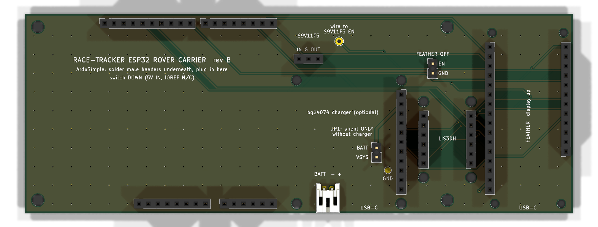

# ESP32 rover carrier board (rev B)

A 146.5 × 53.34 mm, 2-layer motherboard with sockets for every module of the ESP32 rover:

- **ArduSimple simpleRTK2B Budget:** XBee in its own socket, ZED UART2 off (`--role rover`), switch down.
- **Feather ESP32-S3 Reverse TFT:** on 8.5 mm stacking headers, display side up, USB-C at the front edge.

Every module plugs into female sockets on the carrier (J1–J10). The only male pins on the carrier are JP1 and J12.
- **Adafruit LIS3DH.**
- **Pololu S9V11F5.**
- **Adafruit bq24074 charger:** optional.
- **Battery:** connects through a JST-PH socket.

Everything is through-hole and hand-solderable. It replaces the loose wiring in
[docs/esp32-rover-wiring.pdf](../../docs/esp32-rover-wiring.pdf) and the harness in
[docs/esp32-rover-harness.pdf](../../docs/esp32-rover-harness.pdf).



From left to right: the ArduSimple, then the charger with the regulator behind it, then the LIS3DH, then the Feather on
its own at the right end. The XBee's RP-SMA overhangs the ArduSimple's right edge, over the charger. Nothing sits above
the Feather's display, so the enclosure can have a window over it.

Rev B against rev A:

- **The Feather moved to the far right.** In rev A it sat right of the ArduSimple, under the XBee's SMA.
- **The bq24074 turned** so its USB-C faces the front edge, beside the Feather's.
- **New optional connections:** see the table below.

## Files

| File | What it is |
|---|---|
| `esp32-rover-carrier.kicad_pro` / `.kicad_sch` / `.kicad_pcb` | KiCad 10 project |
| `fab/esp32-rover-carrier-gerbers.zip` | Gerbers and drill files, ready to upload to JLCPCB |
| `fab/esp32-rover-carrier-schematic.pdf`, `fab/esp32-rover-carrier-board.pdf` | For review |
| `fab/bom.csv` | Parts list |
| `tools/layout.py` | Module positions and the netlist: the one place to change |
| `tools/gen_sch.py`, `tools/gen_pcb.py` | Regenerate the schematic and the routed board from `layout.py` |

To regenerate after a change to `layout.py`:

```bash
python3 tools/gen_sch.py && ~/Applications/KiCad/KiCad.app/Contents/Frameworks/Python.framework/Versions/Current/bin/python3 tools/gen_pcb.py
```

`gen_pcb.py` places the footprints, routes every net with its own grid router, adds GND stitching vias and pours ground on
both layers. Check the result with:

```bash
~/Applications/KiCad/KiCad.app/Contents/MacOS/kicad-cli pcb drc --schematic-parity esp32-rover-carrier.kicad_pcb
```

Rev B results: 0 violations, 0 unconnected items, 0 schematic-parity issues. The only warnings say that KiCad's library
tables aren't set up on this machine.

## Connections

| Net | Joins |
|---|---|
| GPS_TX | ArduSimple D0 (TX1) → Feather RX (GPIO 38) |
| GPS_RX | Feather TX (GPIO 39) → ArduSimple D1 (RX1) |
| XB_DOUT | ArduSimple D2 (XBEE TX / GPS RX2) → Feather D5 |
| XB_DIN | Feather D6 → ArduSimple D8 (XBEE RX / GPS TX2) |
| 3V3 | Feather 3V (both pins) → ArduSimple IOREF |
| 5V | S9V11F5 VOUT → ArduSimple 5V IN/OUT |
| VSYS | Feather BAT, S9V11F5 VIN, LIS3DH VIN, bq24074 OUT, JP1 pin 2 |
| BATT | Battery JST +, bq24074 VLIPO, JP1 pin 1 |
| SCL, SDA | Feather SCL/SDA ↔ LIS3DH SCL/SDA |
| ACC_INT | LIS3DH INT1 → Feather D10 |
| CHG_N, PGOOD_N | bq24074 ~CHG → Feather D11, ~PGOOD → Feather D12 (open drain; the firmware doesn't read them yet) |
| GND | Everything, plus both copper pours |

The firmware pins are unchanged (`feather_s3_reversetft_socket` build).

### Optional connections

These are wired but not used by the firmware yet, except `GPS_POWER_PIN`, which already exists as a build flag.
[OPTIONAL-CONNECTIONS.md](OPTIONAL-CONNECTIONS.md) explains what each one gives and what it would take to use it.

| Net | Joins | Use |
|---|---|---|
| GPS_EN | Feather A0 (GPIO 18) → pad TP2 | Wire TP2 to the S9V11F5's EN hole, then build with `-DGPS_POWER_PIN=18`. Deep sleep then cuts the ArduSimple and the XBee (about 20–50 mA saved overnight). The GPS loses its almanac unless V_BCKP is supplied, so expect slower fixes after a sleep. |
| GPS_PPS | ArduSimple D13 (TIMEPULSE) → Feather A1 (GPIO 17) | The ZED's 1 PPS edge, for exact timing |
| GPS_EXTINT | Feather A2 (GPIO 16) → ArduSimple D12 (EXTINT) | A hardware wake or time mark for the ZED |
| CHG_DIS | Feather A3 (GPIO 15) → bq24074 ~CE | High stops charging. The bq's 10 kΩ pull-down keeps charging on while the pin floats. |
| ACC_INT2 | LIS3DH INT2 → Feather A4 (GPIO 14) | A second accelerometer interrupt. It's an RTC GPIO, so it can wake the board. |
| FEATHER_EN | Feather EN → J12 pin 1 (pin 2 GND) | Short J12 to switch the Feather off. The regulator and ArduSimple stay on battery power. For a true off switch without a charger, put the switch on JP1 instead of the shunt. |

Feather D9, D13, A5, SCK, MOSI and MISO are still free. The ZED's I2C isn't wired.

There are two differences from the hand wiring:

- **The LIS3DH runs from VSYS, not the Feather's 3V.** The breakout has its own 3.3 V regulator. This shortens the wiring,
  and VSYS stays on in deep sleep, so motion wake still works.
- **The S9V11F5 has no EN pin.** It has only VIN, GND and VOUT; its enable is a small hole on the module. That's why
  GPS_EN goes to a wire pad (TP2) rather than to the socket.

## Battery and charger: JP1

- **No bq24074 fitted:** put the shunt on JP1. The battery feeds VSYS directly, as it does now.
- **bq24074 fitted:** remove the shunt. The battery feeds the charger, and the charger's OUT feeds VSYS. Charge it through
  the bq24074's USB-C on the front edge.

Never fit both. With both in place, the shunt bypasses the charger's battery control. JP1 sits under the bq24074, so you
have to touch it whenever you fit or remove the charger.

## Check before ordering

1. **Print the board at 100 % and press the modules' pins into the paper.**
   - Print `fab/esp32-rover-carrier-fitcheck.pdf` at 100 % ("Actual size"). It shows the outlines, pads and real drill
     holes with no copper pour. The board outline should measure 146.5 × 53.34 mm.
   - The ArduSimple's header pattern is the Arduino Uno R3 layout. I measured it against ArduSimple's pinout image, not a
     drawing.
   - The Feather, LIS3DH and bq24074 positions come from Adafruit's own board files.
2. **Check the S9V11F5 pin order on your module.** The board expects VIN, GND (square pad), VOUT. VOUT is the pin the
   "VOUT→" arrow on the module points to.
3. **Check that your LIS3DH matches the 2809 pinout:**
   - The VIN, 3Vo, GND, SCL, SDA, INT1 row is 0.5" from the CS, SDO, ADC1–3, INT2 row.
   - The board is 0.7 × 1.0".
4. **Check clearance under the ArduSimple.** It sits on its headers about 11 mm above the carrier. Under it are only
   traces, vias and the heads of two M3 case screws (H1, H2). Fit those screws before the ArduSimple goes on.
5. **Check that the XBee's RP-SMA clears the charger.** The connector sits roughly 20 mm above the carrier. The
   bq24074's USB-C top is about 16 mm up. I estimated these heights; I didn't measure them.

## Assembly

1. Solder the female sockets onto the carrier (8.5 mm tall), then the JST, JP1 and (optional) J12.
2. Solder male headers pins-down onto the ArduSimple: 10 + 8 on the top edge, 8 + 6 on the bottom edge.
3. Solder male headers pins-down onto the LIS3DH (both rows), the bq24074 (the 11-pin edge) and the S9V11F5.
4. Solder 8.5 mm stacking headers (a 1x16 and a 1x12) to the Feather instead of its male headers. The housings go on
   the display side, along both long edges, and the long tails come out underneath.
5. Plug in the modules. The Feather's tails go into J5 and J6, display up, with USB-C at the front edge.
   - The Feather sits higher than the other modules: the carrier socket, plus the length of tail left showing.
   - Measure that height before cutting standoffs for the optional M2 hold-downs (H12–H15).
   - Check that the stacking housings line up with the lid window, as the case expects.

## Ordering (JLCPCB)

Upload `fab/esp32-rover-carrier-gerbers.zip` with these settings:

- 2 layers, 1.6 mm FR-4, 1 oz copper.
- HASL finish.
- Any solder mask colour.
- Size 146.5 × 53.34 mm.

Every track and clearance is at least 0.2 mm, well inside the standard process.
