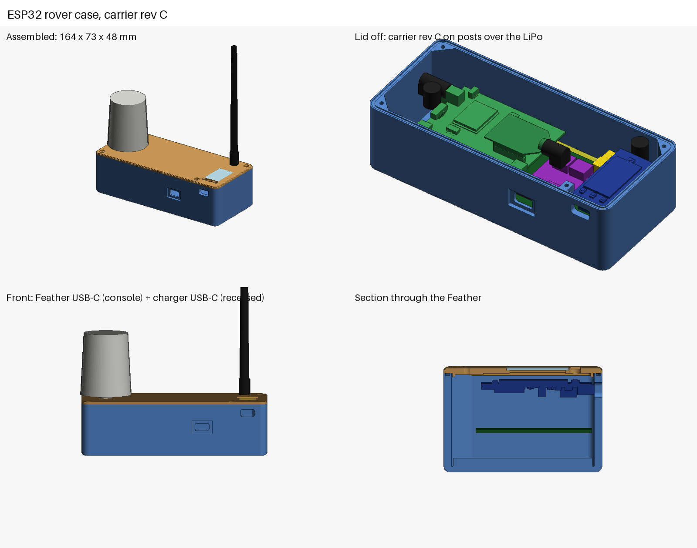

# ESP32 rover case (for carrier rev C)

A sealed, 3D-printed box for the ESP32 rover built on the carrier board in
[../esp32-rover-carrier](../esp32-rover-carrier): **163.7 × 72.8 × 47.8 mm** with a flat lid.



- **Inside, bottom to top:** the 10,000 mAh LiPo (113 × 60 × 12 mm) on the floor, 3.5 mm of foam, the carrier, then the
  ArduSimple (with the XBee in its socket) and the Feather plugged into the carrier.
- **The carrier** screws to two floor posts at its left end (H1, H2). Over the battery, a post on the lid presses its
  third hole (H3).
- **The lid** has a clear window and a TPU keypad (D0, D1, D2) over the Feather's display, the GNSS helix on a bulkhead
  at the left end and the XBee whip on a bulkhead at the back right. Four M3 lid screws: three in the corners, one in a
  boss on the front wall between the charger and the Feather.
- **Front wall:** the Feather's USB-C (console and flashing) and the charger's USB-C (charging, in a small outside
  recess). Both take TPU dust plugs.

This grew out of the flat-lid concept in the enclosure handoff ([ENCLOSURE_HANDOFF.md](ENCLOSURE_HANDOFF.md)). The
difference is that `carrier_case.py` reads every board position from the carrier's `tools/layout.py`, so if the board
moves, the case follows.

## Files

| File | What it is |
|---|---|
| `carrier_case.py` | Builds the case, the clash check and the picture |
| `print/rover_case_base.stl`, `print/rover_case_lid.stl` | The two printed halves, in print orientation |
| `print/TPU_rover_keypad.stl`, `print/TPU_usbc_dust_plug.stl` | TPU parts (print two dust plugs) |
| `print/clash_check.txt` | The last clash check |
| `print/rover_case_dims.json` | Size, window pane, lid-screw and carrier-hole positions |
| `lib/` | The v12 case's geometry code (`build_esp.py`, `parts_esp.py`, `dsl.py`, ...) and its XBee and Feather boxes |
| `lib/ardusimple_step_boxes.json` | One box per part of ArduSimple's STEP (AS-RTK2B-F9P-L1L2-NH-03-R00), from `tools/step_boxes.py` |
| `gerb_render.py` | A quick Gerber rasterizer, to eyeball the carrier's fab zip |

To rebuild after changing the carrier's `layout.py`:

```bash
python3 carrier_case.py
```

It needs `manifold3d`, `numpy` and `pillow` (`pip install manifold3d numpy pillow`). `tools/step_boxes.py` also needs
`cadquery-ocp`, but only to re-extract the ArduSimple boxes from a new STEP.

## The clash check

`carrier_case.py` intersects each printed part with every board, plug and the battery, and prints anything that
touches. The current result ([print/clash_check.txt](print/clash_check.txt)):

- **Base, keypad and window pane:** clear of everything.
- **Lid:** only the intended contacts. Four posts press the ArduSimple's holes by 0.15 mm, and the H3 post presses the
  carrier by 0.1 mm.
- **The printed parts against each other:** clear. **The boards against each other:** clear, including the LIS3DH and
  the regulator under the ArduSimple against the XBee socket pins below its board.
- **Heights:** the charger's JSTs top out at 29.6 mm, under the XBee plug from 33.5 mm. The TFT is 3.3 mm under the
  lid.

The ArduSimple comes from its own STEP. The XBee and Feather come from the boxes the v12 case was checked with. The
charger, LIS3DH and regulator are simple boxes from their datasheet sizes. This is a check of the models, not a test
print.

## Print

PETG or ASA for the base and lid, TPU 95A for the keypad and plugs.

| Part | How |
|---|---|
| `rover_case_base` | Floor on the bed. No supports: the corner blocks start as 45° corbels. |
| `rover_case_lid` | As exported, top face on the bed. Posts and lip face up. No supports. |
| `TPU_rover_keypad` | Plate on the bed, stems up. |
| `TPU_usbc_dust_plug` | Flange on the bed. Print two. |

## Buy (for the case)

| Qty | Part | Notes |
|---|---|---|
| 1 | Clear acrylic or polycarbonate, 1 mm | Cut to 18.4 × 28.6 mm: the window. Glue it into its rebate. |
| 4 | M3 × 12 mm self-tapping screw, pan head (6 mm head max) | Lid screws |
| 2 | M3 × 8 mm self-tapping screw | Carrier H1, H2 into the floor posts |
| 1 | Solid silicone cord, 1/16 in (1.6 mm), 50–60 Shore A, about 0.45 m | Rim groove: the lid seal |
| 1 | Foam tape, 3 mm, about 100 × 50 mm | On top of the battery; the carrier's header tails press into it |
| 1 | RP-SMA male right-angle plug → SMA female bulkhead pigtail, RG316, 10–15 cm | XBee → lid (back right) |
| 1 | SMA female bulkhead → SMA male right-angle pigtail, 10–15 cm | Lid (left end) → ArduSimple GNSS jack |
| 1 | TE Linx ANT-916-CW-HW-SMA half-wave whip (or another SMA-male 915 MHz whip) | XBee antenna |
| 1 | GNSS helix, SMA | The existing antenna |
| — | Clear RTV silicone or E6000 | Glue and seal the window and the keypad |

The board's own parts are in [../esp32-rover-carrier/fab/bom.csv](../esp32-rover-carrier/fab/bom.csv).

## Assembly notes

1. Stick the foam on the battery, then lay the battery in its fence on the floor. Its PH lead comes up behind the
   board, at the back edge, and plugs into the carrier's battery JST, which opens backwards.
2. Fit the carrier on the floor posts with two M3 × 8 screws at H1 and H2. Then plug in the ArduSimple and the
   Feather.
3. Fit the bulkhead pigtails to the lid, and plug them into the XBee and the ArduSimple's GNSS jack before closing.
4. Lay the cord in the rim groove, close the lid and fit its four screws. The lid posts press the ArduSimple, the XBee
   and the carrier's H3 down as the screws tighten.

## Not checked yet

- Nothing has been printed. The fit, the seal and the keypad feel are all unknown.
- The charger, LIS3DH and regulator models are boxes, so check their actual heights against your parts.
- The Feather's front-right corner sits where the v12 case put a lid-screw block. That's why the fourth screw moved to
  the boss between the charger and the Feather.
